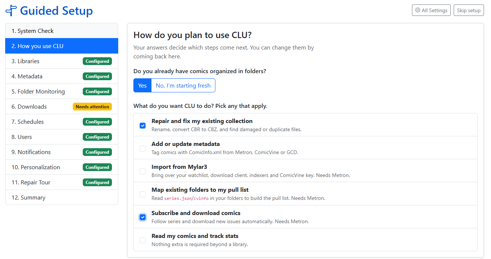
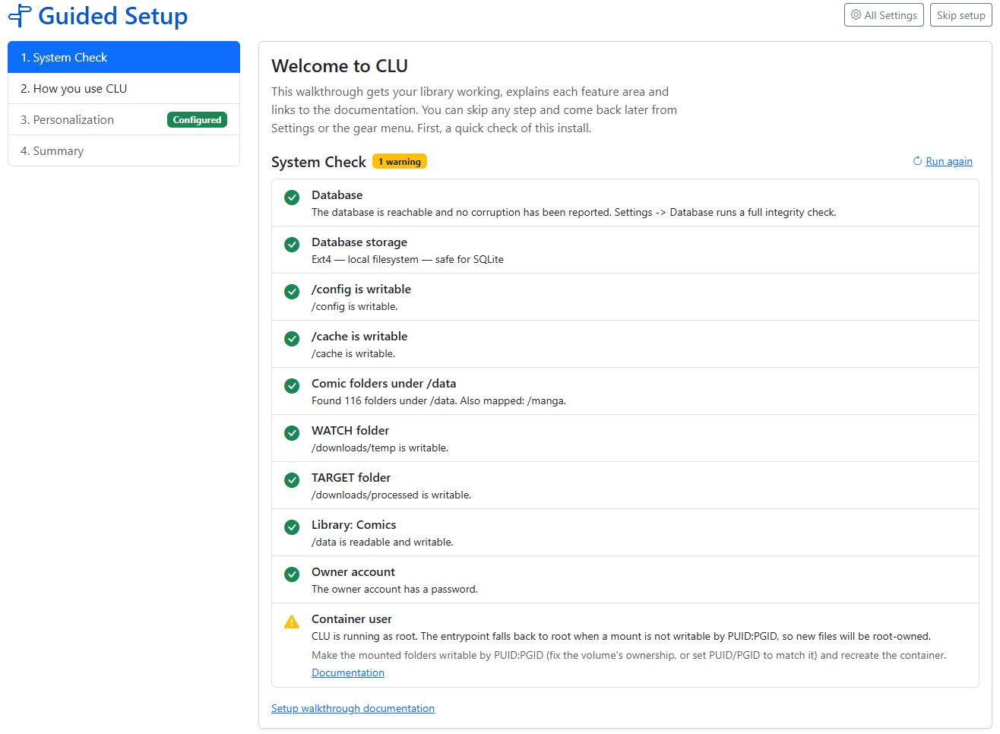
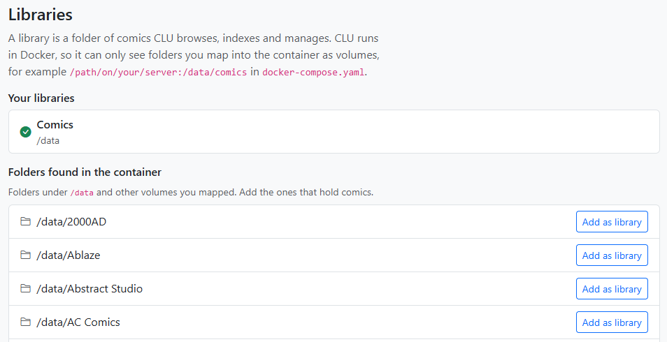
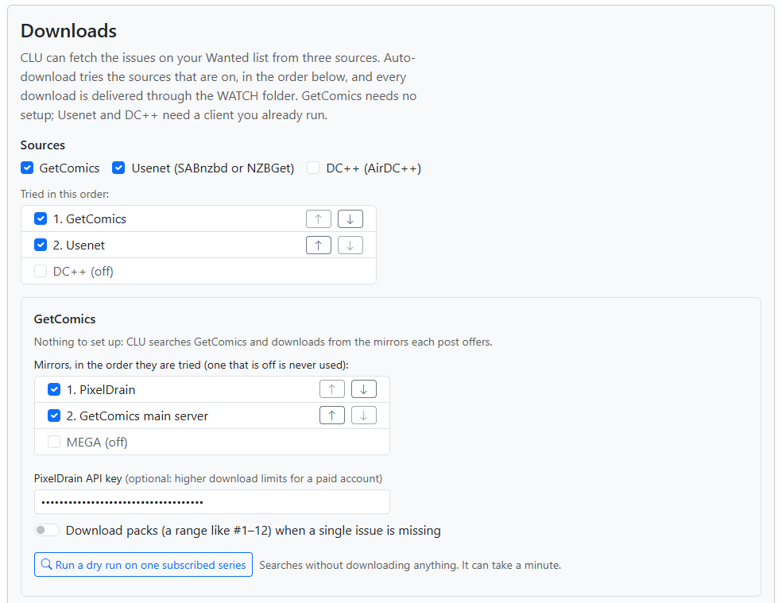
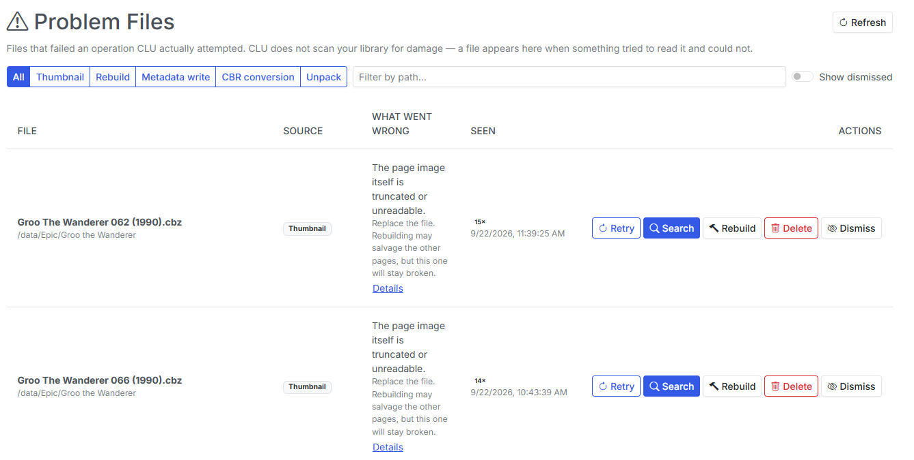

v7.0 is the biggest release in a while, and most of it is about two moments: **the first ten minutes of a new install**, and **existing users wondering if they have everything setup correctly**.

**Guided Setup** is the main reason for the v7 bump. It's a walkthrough that checks your install, asks how you plan to use CLU, and shows you only the settings you need. Underneath it, I **rebuilt how CLU stores its settings**. The old `config.ini` is gone, Folder Monitoring is now controlled by a switch in the UI instead of an environment variable, and your library no longer has to live at `/data`. **Problem Files** also grew into a full library health tool, with a rolling scan, duplicate review, and a way to salvage CRC-damaged comics.

With the release, we are moving to **Auth Token ONLY for Metron**. v6 supported the original Username/Password and enabled Auth Token as a fallback. In v7, Auth Token is the only option for Metron. The existing Username/Password login in the UI has been removed. Visit [Metron --> Account --> API Tokens](https://metron.cloud/accounts/tokens/) to generate yours.

<!-- more -->
### Guided Setup

The most common support question I get isn't about a feature. It's "I installed it, now what?" CLU started out as a few hand-coded scripts and has grown into a multi-feature comic management tool, and I realized that it's not always obvious how to get started. Guided Setup is meant walk users through setting CLU up step by step.

{: .center-image }

**When it shows up:**

- **New install:** the owner's first visit to the home page opens Guided Setup, once.
- **Upgraded install:** nothing redirects you. You get a one-time banner offering to run it, and you can dismiss it.
- **Any time after that:** use **Run Guided Setup** on the Settings page, or **gear menu → Guided Setup**.

#### Step 1: System Check

Guided Setup starts by checking your install without changing anything. It covers the database, whether `/config` is on storage that's safe for SQLite (not a CIFS/NFS share), whether `/config` and `/cache` are writable, which folders are mapped under `/data`, whether WATCH and TARGET are outside your library, whether each library can be read and written, and whether the container runs as your `PUID` rather than root.

{: .center-image }

Every row says how to fix what it found. Only a failed **Database** check stops you from continuing. Everything else is a warning you can come back to. Each check gives up after 5 seconds, so a sleeping NAS can't hang the page.

The same checks are now on a **System Check** tab on the Logs page, and they're included in the debug package as `preflight.json`. If you ask for help on Discord, attaching that file will usually save us a round of questions.

#### Step 2: How do you plan to use CLU?

This question decides which steps you see. Starting fresh gets you every section in order, and you can skip any of them. If you already have comics in folders, pick as many of these as apply:

| Use case | Sections it adds |
| --- | --- |
| Repair and fix my existing collection | Libraries, Folder Monitoring, Notifications, Library Health |
| Add or update metadata | Libraries, Metadata |
| Import from Mylar3 | Libraries, Metadata, Mylar3 Import, Downloads |
| Map existing folders to my pull list | Libraries, Metadata, Pull List Scan |
| Subscribe and download comics | Libraries, Metadata, Folder Monitoring, Downloads, Schedules, Users, Notifications |
| Read my comics and track stats | Libraries, Users |

Each step explains what the section does, shows the fields that matter, and links to the full Settings tab for everything else. **Every step saves as you go.** There's no "save everything" button at the end to forget. Libraries lists the folders the System Check found, each with a one-click **Add as library**. Downloads only enables **Save** after a client or indexer passes a **Test**.

| {: .center-image } | {: .center-image } |
| :---------: | :---------: |
| Libraries | Downloads |

You can skip a step, leave halfway through, and pick up where you left off. The **Summary** at the end shows each section as *Configured*, *Needs attention*, *Not set up* or *Skipped*, and has a **Download summary (for support)** button.

On an existing install, Guided Setup doubles as a health check. Run it to see what's configured, what's broken, and what you aren't using yet.

**Mylar3 users:** the new [Mylar3 importer](../../features/mylar-import.md) is one of the steps. Upload your `mylar.db` and `config.ini`, and CLU brings over your watchlist, issue status, download client, indexers and ComicVine key. It also writes the missing `cvinfo` and `series.json` files for imported series.

More in the [Guided Setup docs](../../getting-started/guided-setup.md).

***

### Under the Hood: Settings, Monitoring, and `/data`

Guided Setup couldn't work on top of how CLU used to store settings. Some lived in `config.ini`, some in the database, and Folder Monitoring was an environment variable you could only change by editing your compose file. So before building the wizard, I refactored the foundation.

**All settings now live in the database.** On first start, v7 imports your `config.ini` once, renames it to `config.ini.migrated`, and never reads it again. Any value already stored in the database is left alone. Every part of CLU, including the separate monitor process, now reads settings from one place, so a change in the UI takes effect within a few seconds without a restart.

**Folder Monitoring is a live switch.** `MONITOR=yes` used to be read once, when the app started. It's now an **Enable Folder Monitoring** toggle on the File Processing tab, with a **Running / Stopped** badge. A small supervisor starts and stops the monitor when you flip it, restarts it if it crashes, and re-points it when you change WATCH. As a side effect, this also fixes duplicate monitors appearing after a worker restart.

**Your library doesn't have to be at `/data`.** A user setting their library to `/comics` broke several views quietly. Multiple places in the code still assumed `/data` was the root of your library. Some of those failures were visible, like All Books returning errors and Stats showing zero publishers. Others did their damage quietly:

- Moves inside `/comics` never updated the file index, so wanted issues were never reconciled.
- The file watcher only watched `/data`. There's now one watcher per library root.
- ComicVine auto-move created folders under `/data`, which is the container's own disposable storage when `/data` isn't mounted.
- The trash's empty-folder cleanup only protected `/data`, so trashing the last item in another library root could remove the root itself. It now protects every library root, plus WATCH, TARGET and the trash.

All of those are fixed, and a test now fails the build if anyone adds a new hard-coded `/data`.

***

### Problem Files Becomes Library Health

[Problem Files](../../features/problem-files/index.md) arrived in v6.5 with an honest limitation: it only knew about files CLU had *already* tripped over. An empty page meant "nothing has failed," not "your library is fine."

v7 adds the other half.

{: .center-image }

#### The library health scan

The scan is **opt-in** and **rolling**. Each run opens a batch of comics (200 by default, every 6 hours), oldest-checked first, and confirms they can actually be read. A large library is covered over several runs instead of in one long job. The scan also finds:

- damaged archives and bad CRCs
- orphaned files and **empty folders**
- incomplete or missing `series.json`
- stray files (TARGET is excluded, because it's supposed to hold files in transit)
- duplicate copies

The **Library health** card shows two numbers, and they mean different things. **Coverage** is how much of the library has a current result, so 40% checked means 60% *unknown*, not 60% healthy. **Score** starts at 100 and loses points for each problem found.

#### Salvage rebuild and Edit pages

The old Rebuild button was honest about its odds: a real CRC error aborts extraction, so rebuilding usually failed the same way the original operation did. v7 adds two tools that fix more files:

- **Salvage rebuild** is for `Bad CRC-32` rows. It re-reads each damaged page while ignoring the checksum, and keeps the page only if the image fully decodes. The comic is rewritten **only if every damaged page decodes**. Otherwise the file is left byte-for-byte untouched, and the row names the page that couldn't be saved.
- **Edit pages** opens the CBZ editor with damaged pages flagged, so you can delete the bad page and keep the rest of the issue. After you save, CLU decodes every page again before it clears the row. Repacking gives the archive fresh CRCs, so a broken page left in place would otherwise look fixed.

When neither works, **Find a replacement** is still one click away.

#### Duplicates

The new [Duplicates](../../features/problem-files/duplicates.md) page reviews the groups the scan finds:

- **Exact** groups are byte-for-byte identical files.
- **Likely** groups share series, issue and year tags plus a matching filename, or look like `Comic (1).cbz` next to `Comic.cbz`. Check these before you trash anything, because a variant cover can match on tags.

CLU pre-selects a copy to keep, preferring one that's undamaged, tagged, a `.cbz`, larger, and newer, in that order. **Compare** shows two copies side by side, including image resolution. **Keep selected, trash the rest** sends the others to the trash, and you can still restore them from there. **Dismiss** hides a group until the next scan, and **Not duplicates** hides it for good.

#### Smaller changes

- Rows show **full paths** instead of truncating them, and *What went wrong* gets the extra width.
- The **Details** button is gone, since the row already shows that information.
- **Empty folders delete without a confirmation step.** Their leftovers can all be recreated, and the server checks again that the folder is empty before deleting. Deleted rows turn red and fade out, so you can see what went.
- **Refresh all series.json** from the Problem Files page, with a report of each folder that failed.

***

### Also in v7

- **Provider tracking:** CLU records which metadata provider tagged each file. You can re-tag with a single provider, or backfill only the blank fields.
- **Year breaks ties** when moving a download into one of two series with the same name.
- **Download fallbacks:** when DDL has no results, CLU tries Usenet and DC++. Scheduled runs now report what they searched, queued and missed.
- **Metron:** mokkari 5.0's moves to token-only auth, and "what changed?" checks no longer come from a stale cache.
- **Reading lists** match entries by ComicVine id, which fixes misses on titles with colons and variants. The Reading Lists and Pull List pages now load a page at a time on the server.
- **Weekly Releases** has a Subscription filter next to Publisher.
- **New themes:** Gruvbox Dark and all four Catppuccin flavors (Latte, Frappé, Macchiato and Mocha).

A big thank-you to **@esanchezm**, who contributed for the first time this release: the themes, reading-list matching, pagination, and re-queuing thumbnail jobs after a restart.

!!! warning "Security fix — please upgrade"
    v7.0 fixes an unauthenticated arbitrary file deletion through the `/stream` endpoint (GHSA-4v7f-qm46-8fw4). If your CLU is reachable by anyone you don't fully trust, upgrade now.

***

### Notes for Upgraders

- **`config.ini` is migrated automatically.** After the first start you'll see `config.ini.migrated` in `/config`. CLU won't read it again, but keep it around until you've confirmed your settings carried over.
- **`MONITOR` is retired.** If you had `MONITOR=yes`, monitoring stays on. If you never set it, monitoring stays **off**. That matters if you use Usenet or DC++, because those downloads are processed by the monitor. Turn it on in **Settings → File Processing**. You can remove `MONITOR` from your compose file, and CLU logs a warning while it's still there.
- **Libraries can live anywhere you map them.** `/data` is still the default, but `/comics` or a second root now works everywhere.
- **The health scan is off until you turn it on.** Do that from Problem Files or from the Library Health step in Guided Setup.
- **Guided Setup won't take over an existing install.** You'll see a banner once, and that's it.

That's v7.0: a setup that tells you what's wrong before you have to ask, settings that stay in one place, and a library that can tell you when it's broken and help you fix it. Feedback is welcome via Discord or GitHub.

Previous release: [v6.7 — Local AI Recommendations, One Work Queue, & Reader Polish](https://clucomics.org/blog/2026/10/07/v67---local-ai-recommendations-one-work-queue--reader-polish/)
