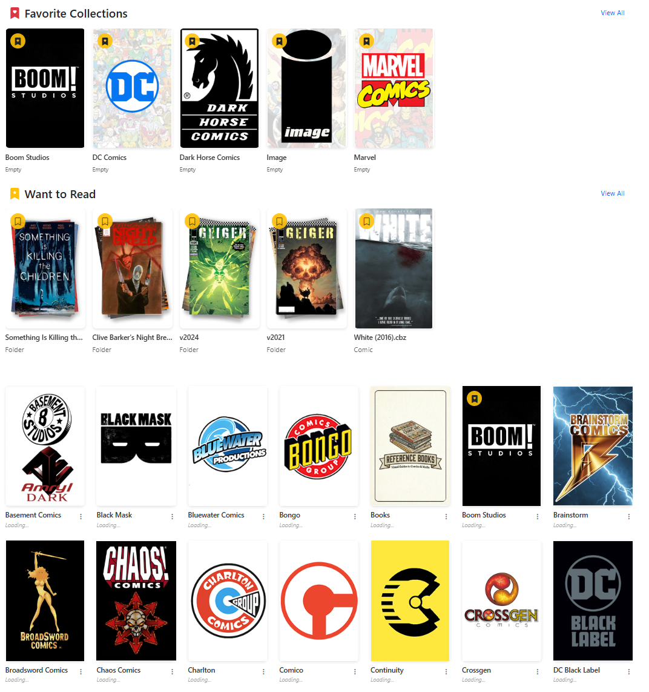
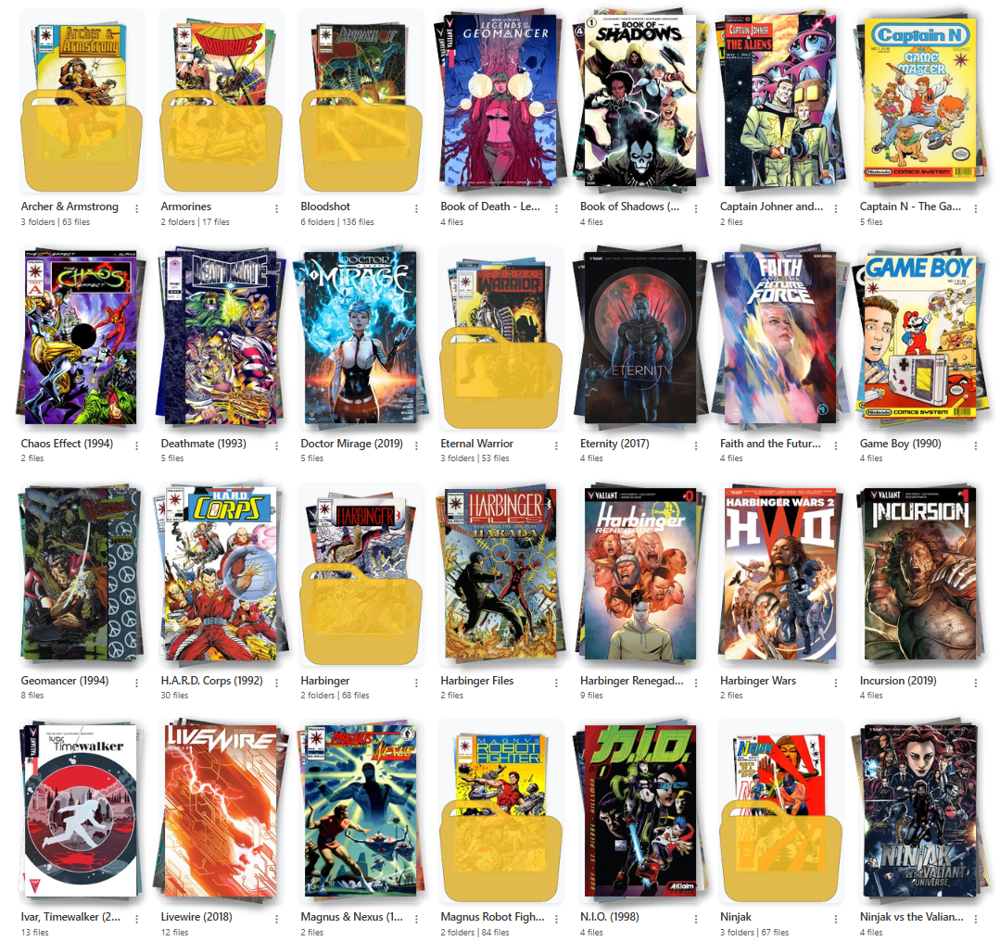
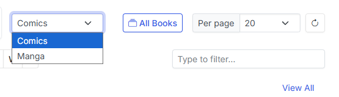
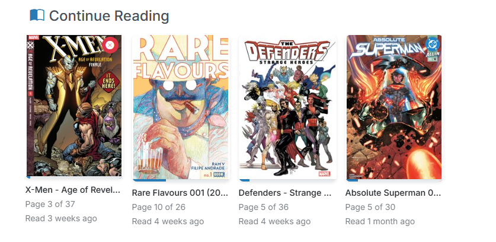
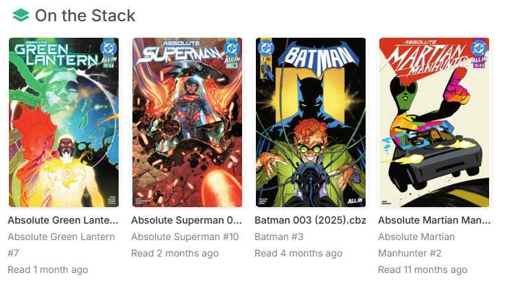
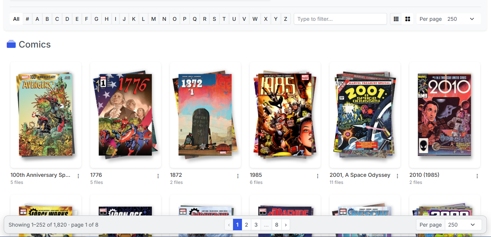
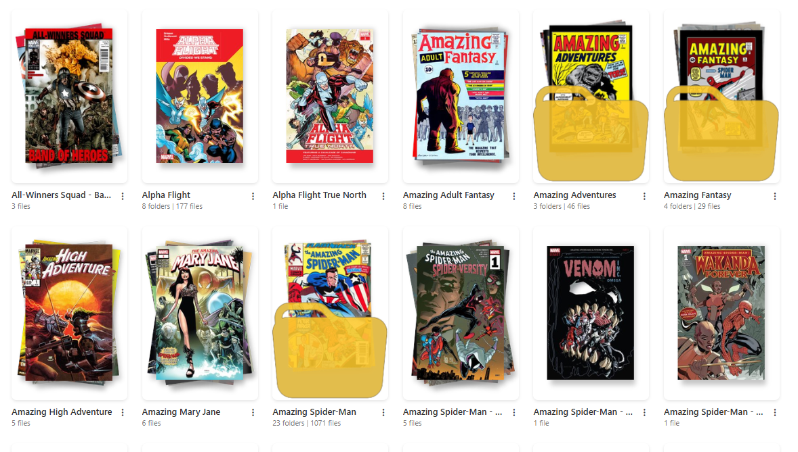

# Collection Homepage

| { width="300" }      | { width="300" }                          |
| :---------: | :----------------------------------: |
| Example Collection Landing Page with Favorites and Reading Lists | Example Collection Publisher Page with Nested Folders |

CLU provides a visual browser to navigate your collection. Generally this is grouped by publisher, but CLU will render any folder structure you have.

## Viewing Multiple Libraries

{: .center-image}

If you have multiple libraries, you can select which library you want to view from the dropdown menu in the top left of the collection page.

## Sections

Currently, there are up to 6 sections that can show on the collection page:

!!! info "Dashboard Customization"
    The order of these sections and which ones are hidden is a **per-user** setting. Arrange your dashboard from [My Account](../users/my-account.md#dashboard-layout); administrators can set the [site default](../app-settings/personalization.md) for new accounts.

### Publisher

This is the default section. It displays all publishers in your collection and is always available. Clicking into a publisher displays all series folders or issues within that publisher.

!!! note
    In documentation, this is referred to as the "Publisher" section, but it reflects whatever folder structure you have in your collection.

With multiple libraries configured, this section updates dynamically based on your selected library. Your **Per page** choice when browsing is saved and restored across navigation.

### Favorite Collections

Displays all publishers that have been marked as a favorite. You can favorite a publisher by clicking the <i class="bi bi-bookmark-heart fs-2 text-icon"></i> icon in the top left of the publisher list.

### Want to Read List

This section draws from two sources:

- **Flagged files and folders**: Mark a series folder or issue as "Want to Read" by clicking the <i class="bi bi-bookmark fs-2 text-icon"></i> icon in the top left of the list, or via the **Want to Read** action in the folder dropdown (see [Additional Features](../file-management/additional.md)).
- **[Bookmarked reading lists](reading-lists.md#bookmarking-a-list)**: Each bookmarked list appears as a single card featuring a cover stack, read/total progress count, and a direct link to the list.

### Continue Reading

{: .center-image}

Displays issues that have been started but not completed. Clicking the <i class="bi bi-x-circle-fill text-danger"></i> icon removes an issue from this section.

### Discover

Generates personalized recommendations based on your reading history and Want to Read list. Recommendations are manually triggered so you can run them on demand when looking for something new. You must configure an API key in [Recommendations](../app-settings/personalization.md#recommendations) to enable this feature.

### On the Stack

{: .center-image}

The *On the Stack* section alerts you to new issues for series that you are currently reading, ensuring you stay caught up.

For example, if you have read `Absolute Batman 001` through `Absolute Batman 017`, issue `018` will appear on the stack as soon as it is added to your library.

!!! note
    Only the next unread issue in sequence is shown. If both `Absolute Batman 018` and `Absolute Batman 019` are unread, only issue `018` is displayed until it is marked as read.

On the Stack draws from two sources:

- **Series in your [Pull List](../pull-list/pull-list.md)**: If you want to exclude certain series, toggle the stack option on the [Series page](../pull-list/series.md).
- **[Bookmarked reading lists](reading-lists.md#on-the-stack)**: Each bookmarked list contributes its next unread issue, displayed with a list-name badge.

If a bookmarked list and a subscribed series point to the same next issue, it is deduplicated and shown once.

### Recently Added

Displays the last 100 issues added to your collection.

## Browsing the Grid

### All Books

By default, **All Books** sorts by series, then parent folder, then issue number (with cover year used as a tiebreaker). This keeps different volumes of the same series grouped together. Volumes kept loose in the same folder sort by issue number within that folder.

### The Pager

The pagination control is sticky, pinning to the bottom of the viewport while browsing and settling inline at the true bottom of the page.

{: .center-image}

/// caption
The pager pinned to the bottom of the viewport over a full grid.
///

The pager includes:

- **Windowed page numbers** with ellipsis navigation for large libraries.
- A **"Showing X–Y of Z"** readout.
- A mirrored **Per page** selector so you can adjust page size without scrolling back to the top.
- Seamless compatibility with Multi-Select mode so bulk action controls do not obstruct pagination.

### Card Size

Toggle between **Standard** and **Large** card sizes in the filter bar.

{: .center-image}

Like **Per page**, this setting is saved in your browser rather than your account, allowing device-specific preferences (e.g. standard on desktop, large on tablet).

## Folder Art

Folder cover art is generated automatically as you browse. When the grid encounters a folder without cached art, it queues a background task to generate it.

Folder art generation behavior:

| Behavior | Detail |
| --- | --- |
| **Serialized processing** | Archive extraction is processed one folder at a time to preserve system resources. |
| **Request deduplication** | A folder is never queued more than once concurrently. |
| **Backoff on error** | Folders that fail thumbnail generation are paused for 6 hours before retrying. |
| **Preserves existing art** | Uploaded or pre-existing art is never overwritten by automatic generation. |

CLU recognizes `folder.png`, `folder.jpg`, `folder.jpeg`, `folder.gif`, and `folder.webp` as folder art.

Generated folder art supports **four styles** — Fanned Stack (default), Single Image, Isometric Cascade, and 2x2 Mosaic Grid — selectable site-wide on the [Personalization](../app-settings/personalization.md#folder-thumbnail-style) page. You can pin a specific issue's cover as a folder's primary art with **[Set as Folder Thumbnail](issues.md#set-as-folder-thumbnail)**, or restyle all existing folders with **[Regenerate All Thumbnails](../app-settings/personalization.md#regenerate-all-thumbnails)**.

Automatic folder art generation can be disabled in [File Processing Settings](../app-settings/file-settings.md).

## Comic Covers

Comic covers update automatically whenever an issue is edited, rebuilt, or retagged. The grid also detects when a comic archive is newer than its cached thumbnail and updates accordingly.

- **Non-image formats**: Files without cover extractors (such as standalone PDFs) and macOS system sidecars (`._*`) are automatically skipped during generation and are not flagged as errors.
- **Corrupted archives**: If cover extraction fails due to a damaged archive, the file is logged to the **[Problem Files](../problem-files/index.md)** page under **Thumbnail** with the exact error, where you can retry extraction or [find a replacement](../problem-files/replacing-a-file.md).

## Access in a Multi-User Install

In a [multi-user install](../users/index.md):

- **Readers** see a clean browsing grid without action menus, Multi-Select, or bulk action bars (which are reserved for [Clerk](../users/roles.md) and Admin roles).
- Content visibility is governed by [library and folder grants](../users/library-and-folder-access.md). **Recently Added** is automatically filtered to include only folders the current user has permission to view.
