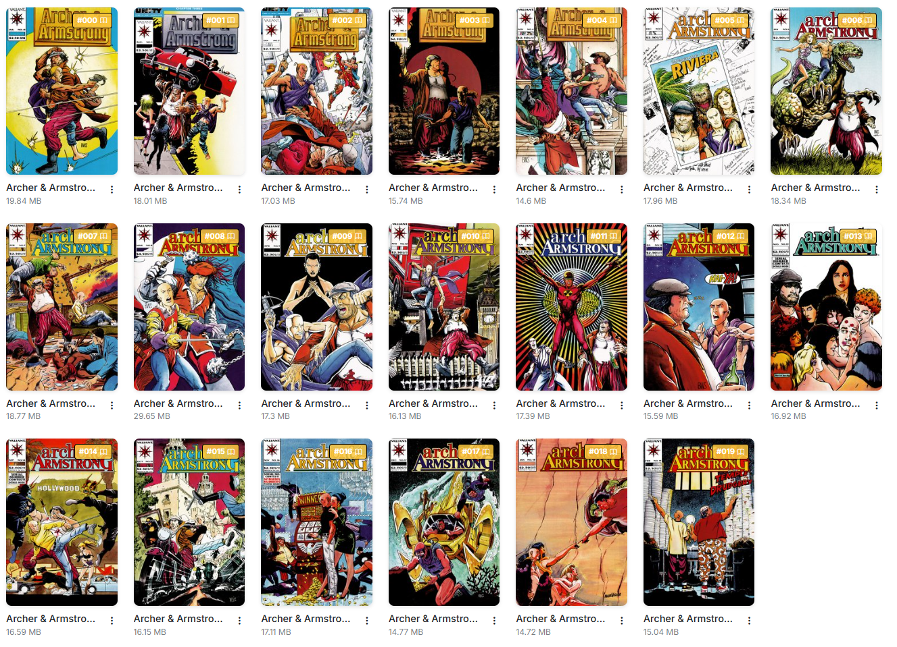
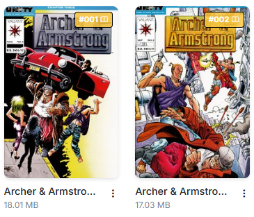
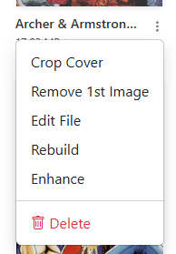

# Collection Browsing (Issues)

{: .center-image}
/// caption
Example Issues Page
///

When you open a series folder, CLU displays a grid of all comic issues in that folder.

The issue number is displayed in the top right corner of each cover for quick identification.

{: .center-image}
/// caption
Issue Number
///

## Issue Options

Click the <i class="bi bi-three-dots-vertical fs-2 text-icon"></i> menu on any issue card to access file actions:

{: .center-image}
/// caption
Example Issue Dropdown Menu
///

1. **Crop Cover**: Crops the first image of the CBZ, saving the right half as the new cover and the full spread as the second page. See [Crop Cover](../single-file-features/crop.md).
2. **Remove First Image**: Removes the first image from the issue. It is recommended to check the issue in [Edit File](../single-file-features/edit.md) first to confirm the target image is truly page one. See [Remove First Image](../single-file-features/remove.md).
3. **Edit File**: Unpacks the CBZ archive to let you reorder, remove, or edit pages and metadata. See [Edit File](../single-file-features/edit.md).
4. **Rebuild**: Rebuilds an incorrectly structured CBZ archive or converts a CBR file into a clean CBZ. See [Rebuild](../single-file-features/rebuild.md).
5. **Enhance**: Enhances image quality across all pages in the issue. See [Enhance](../single-file-features/enhance.md).
6. **Set as Folder Thumbnail**: Pins this issue's cover as the primary art for the folder. See [Set as Folder Thumbnail](#set-as-folder-thumbnail) below.
7. **Delete**: Deletes the issue file from disk. See [Delete](../single-file-features/delete.md).

## Set as Folder Thumbnail

You can pin any comic issue's cover as the parent folder's cover art.

Click the <i class="bi bi-three-dots-vertical fs-2 text-icon"></i> menu on the issue whose cover you want to use and select **Set as Folder Thumbnail**. The folder's art is regenerated immediately with that issue featured as its primary cover.

"Primary" adapts automatically to each [folder art style](../app-settings/personalization.md#folder-thumbnail-style):

| Style | Where the pinned cover appears |
| --- | --- |
| **Single Image** | Displays as the entire cover image. |
| **Fanned Stack** | Positioned as the front card of the stack. |
| **Isometric Cascade** | Positioned as the front card of the cascade. |
| **2x2 Mosaic Grid** | Positioned as the top-left tile. |

Pinned covers are stored per folder and persist through bulk restyling, so running [Regenerate All Thumbnails](../app-settings/personalization.md#regenerate-all-thumbnails) applies the new style without losing your selection.

!!! note "Comics only"
    Only comic archive files can be pinned as folder thumbnails. Pinned text or auxiliary image files cannot be used.

!!! tip "Changing or removing a pinned thumbnail"
    To change the pinned cover, select **Set as Folder Thumbnail** on another issue. To use a custom image instead, place a `folder.png`, `folder.jpg`, or `folder.webp` file in the folder — custom uploaded art always takes precedence over generated thumbnails.