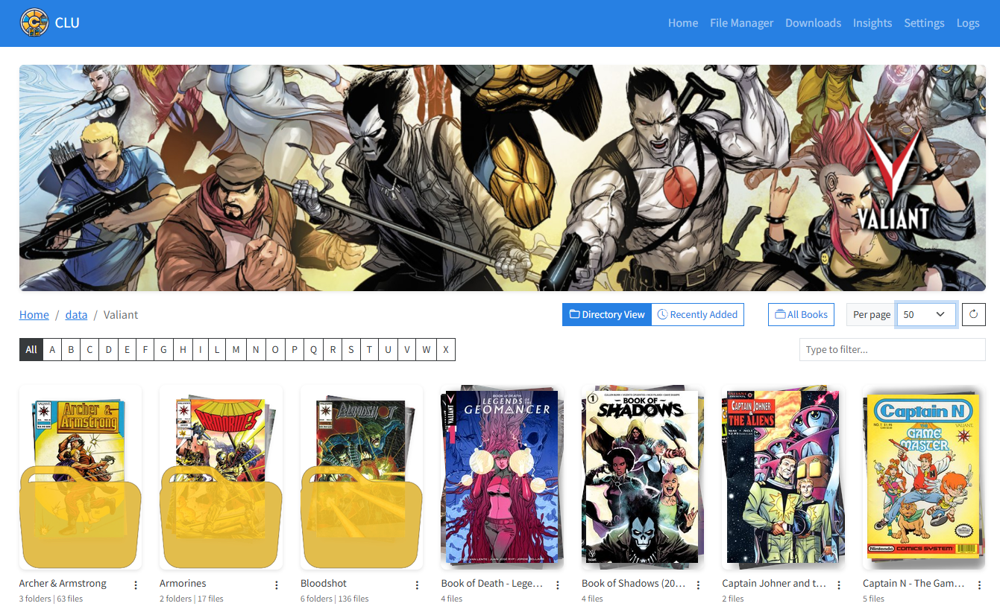
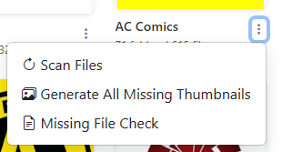
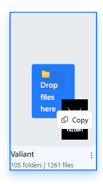

# Collection Browsing (Publishers)

/// caption
Example Publisher Page with Custom Header
///

CLU allows you to visually browse your collection starting from your root library (`/data`) directory. While this documentation refers to top-level directories as "Publishers", they represent whatever folder structure exists in your storage.

Each folder includes a <i class="bi bi-three-dots-vertical fs-2 text-icon"></i> menu providing folder-level management actions.

## Publisher Folders

{: .center-image}

The folder menu provides three options:

- **Scan Files**: Scans the directory and updates the database for this publisher, indexing newly added files and structural changes.
- **Generate Missing Thumbnails**: Generates cover thumbnails for all folders that are currently missing art. See [Generating Thumbnails](series.md#generating-thumbnails).
- **Missing File Check**: Analyzes the folder to detect missing issues in series sequences. See [Missing File Check](../directory-features/missing.md).

### Custom Headers

Folders support custom banner headers. CLU checks for an image file named `header.png`, `header.jpg`, or `header.gif` in the publisher folder. If present, it is rendered across the top of the page. The recommended image resolution is **2200×516 pixels**.

### Custom Thumbnails

All folders support custom thumbnails. Place an image named `folder.png`, `folder.jpg`, `folder.jpeg`, `folder.gif`, or `folder.webp` in the directory, and CLU will use it as the folder's cover image. Recommended dimensions are **200×300 pixels**.

### Uploading a Publisher Thumbnail

You can quickly assign a custom thumbnail by dragging and dropping an image file directly onto the publisher card from your computer.

{: .center-image}
/// caption
Uploading a Thumbnail via Drag and Drop
///

Once uploaded, the new cover art displays automatically on the publisher card.

### Favorite Publisher

Click the <i class="bi bi-bookmark-heart fs-2 text-icon"></i> icon in the top left of any publisher card to mark it as a favorite. This pins the publisher to the **Favorite Collections** row on your dashboard for fast access.

### Navigating to Series

Clicking any publisher card opens that publisher's page, displaying all child series folders or standalone comic issues within it.
