# Reading Lists

CLU supports importing curated reading lists and publisher story arcs from multiple sources, as well as creating, organizing, and sharing your own custom lists.

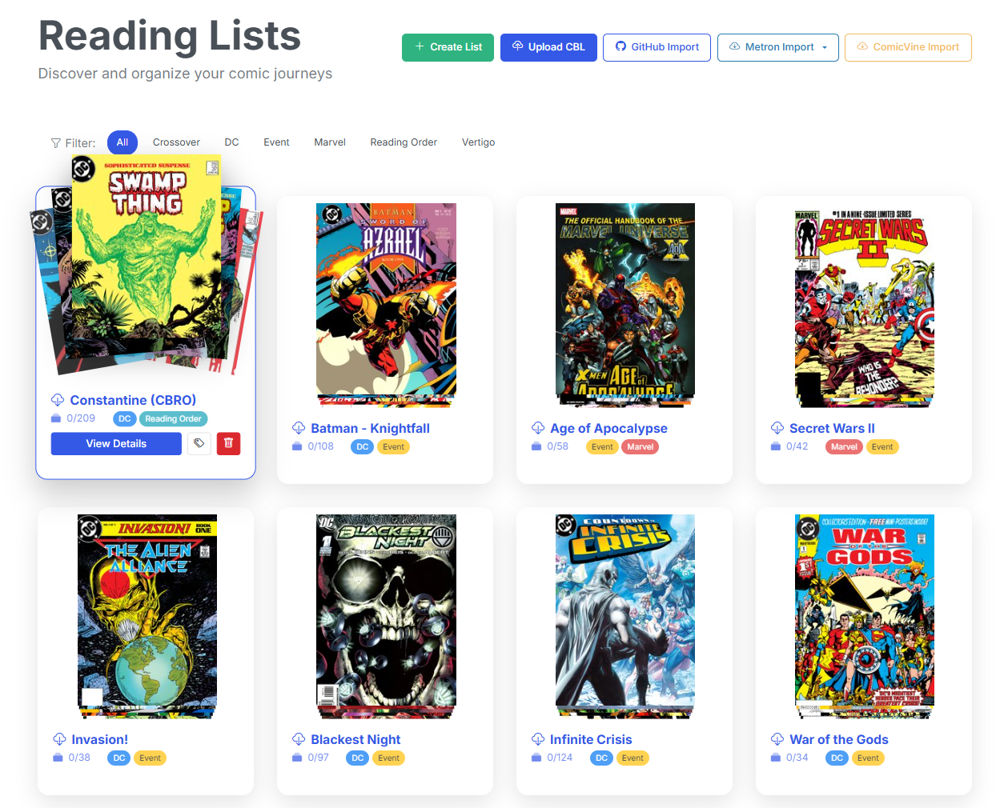{: .center-image}
/// caption
Reading Lists Page
///

## Importing Reading Lists

You can import reading lists from several sources:

- **DieselTech GitHub Repository** — Browse and import from a curated repository of ComicBookLover (`.cbl`) reading lists.
- **Import by URL** — Paste a direct URL pointing to a `.cbl` file on GitHub or the web.
- **Upload CBL File** — Upload a local `.cbl` or `.xml` file from your device.
- **Metron Reading Lists** — Search and import curated reading lists from the Metron comic database.
- **Metron Story Arcs** — Import publisher story arcs from Metron as ordered reading lists.
- **ComicVine Story Arcs** — Import major events and story arcs from ComicVine.

### GitHub Repository Browser

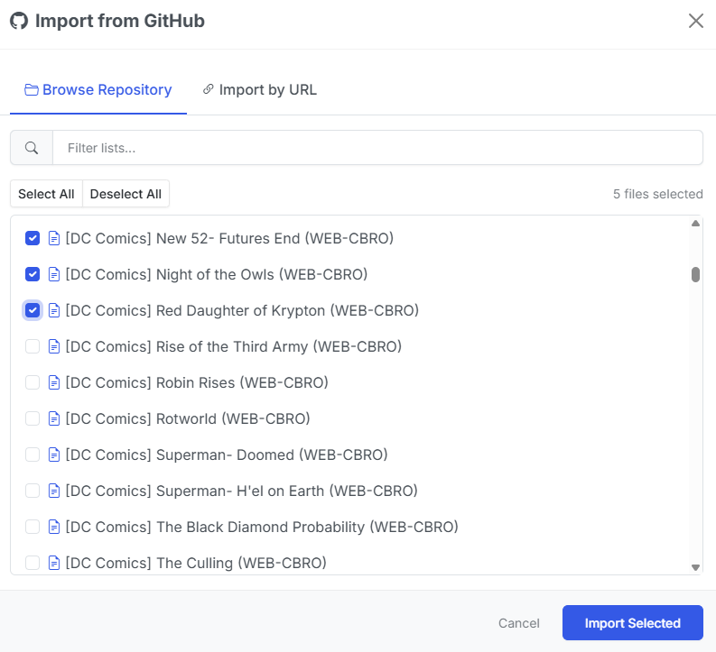{: .center-image}
/// caption
GitHub Import Modal
///

Click **GitHub Import** to open the browser modal. The **Browse Repository** tab indexes reading lists from the DieselTech/CBL-ReadingLists repository:

1. Use the search input to filter lists by title or character.
2. Select files using the checkboxes, or choose **Select All** / **Deselect All**.
3. Click **Import Selected** to initiate a batch import.

Selected lists are downloaded and processed in the background. Up to 5 imports process concurrently, with the remainder queued and visible in the progress tracker.

### Import by URL

Select the **Import by URL** tab to paste a direct link to any `.cbl` file on GitHub. CLU automatically converts standard GitHub blob links to raw content download URLs.

### Upload CBL File

Click **Upload CBL** to upload a `.cbl` or `.xml` file directly from your local machine. The list is parsed and added immediately.

### Metron Import

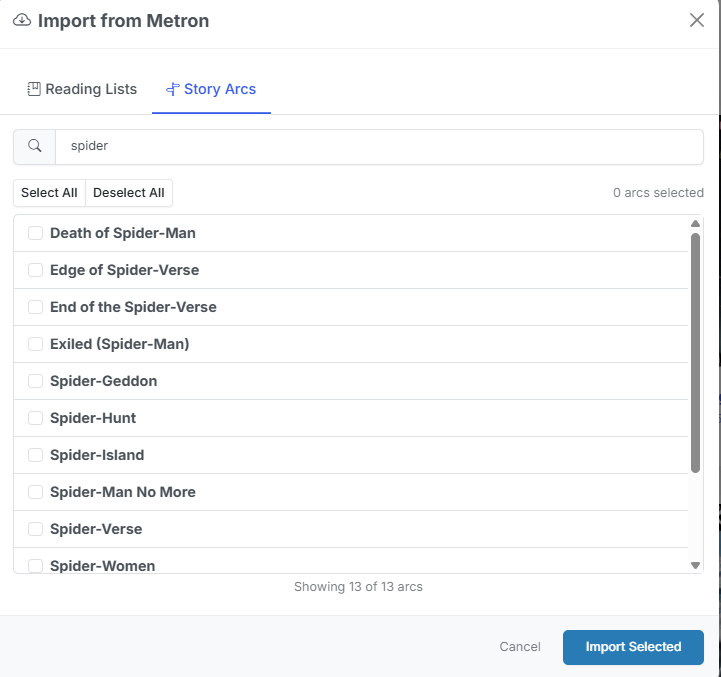{: .center-image}
/// caption
Metron Import Modal
///

Click **Metron Import** to open the Metron browser. Two options are available:

- **Reading Lists** — Search and browse Metron's curated reading lists. Issue reading orders and descriptions are preserved.
- **Story Arcs** — Browse publisher story arcs with infinite scroll pagination. Issues are ordered according to their chronological arc sequence.

*Note:* Metron credentials must be configured in **Settings > Metadata Providers** prior to importing.

### ComicVine Import

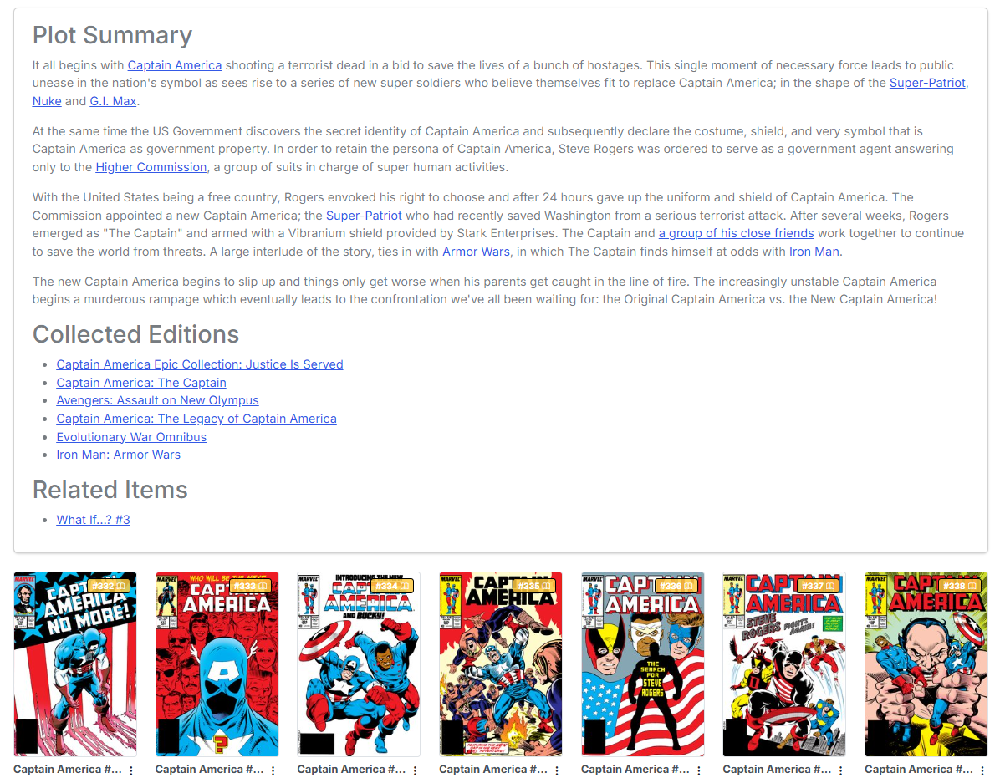{: .center-image}
/// caption
ComicVine Import Modal
///

Click **ComicVine Import** to search and import crossover story arcs and events from ComicVine. A ComicVine API key must be configured in **Settings > Metadata Providers**.

### Provider Import Features

When browsing Metron or ComicVine imports, the modal provides:

- **Search filter** — Live filter results by name as you type.
- **Bulk selection** — Use **Select All** and **Deselect All** to import multiple arcs at once.
- **Selection counter** — Displays the total count of selected items.
- **Infinite scroll** — Automatically loads additional arc pages while scrolling.

### Filtering and Searching Lists

On the main Reading Lists page, a **tag filter bar** appears whenever lists have tags assigned. Click a tag to isolate lists with that tag, or select **All** to view every list.

### Import Status

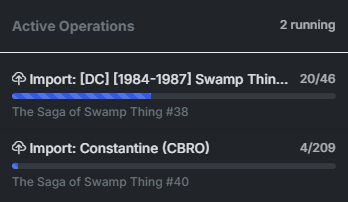{: .center-image}

During active imports, the header displays a live progress status bar showing current issue matching, completed items, and remaining items in the queue.

## Keeping an Imported List Up to Date

### Sync

The **Sync** button re-reads the original remote source and updates your reading list to reflect newly published or updated reading orders:

| Source | Sync Action | Change Detection |
| --- | --- | --- |
| **GitHub CBL URL** | Re-downloads the remote `.cbl` file | File contents check |
| **Metron reading list** | Re-reads the list from Metron | Last-modified timestamp |
| **Metron story arc** | Re-checks issue members of the arc | Arc membership diff |
| **ComicVine story arc** | Re-checks issue members of the arc | Arc membership diff |

If no upstream changes have occurred, Sync finishes immediately. When changes are found, the reading list rebuilds asynchronously in the background.

!!! note "Sync Availability"
    Custom lists created by hand or imported via local file upload do not have an upstream URL and do not display a Sync button. To update a list you already own, use **Sync** rather than re-importing, which would produce a duplicate list.

### Sync vs. Re-match

The **Sync** and **Re-match** buttons serve distinct purposes:

| Button | Target | Purpose |
| --- | --- | --- |
| **Sync** | Remote Source | Re-reads the upstream provider (GitHub, Metron, ComicVine) and adjusts list contents to match. |
| **Re-match** | Local Library | Re-scans your local files to match open entries against newly acquired or renamed files. |

Use **Sync** when the upstream reading list has been modified. Use **Re-match** when files in your library have been added, renamed, or converted.

### Scheduled Syncing

Automated recurring sync can be configured in [Reading List Sync Schedule](../app-settings/schedules.md#reading-list-sync-schedule) to keep all remote lists updated automatically.

## Track Wanted

Click the **Track Wanted** <i class="bi bi-binoculars"></i> toggle on any reading list to monitor missing issues:

- Any entry on the list without a matching local file is flagged as a wanted issue.
- Missing entries appear on the [Wanted](../pull-list/wanted.md#from-reading-lists) page under the **From Reading Lists** tab and are searched during automated nightly downloader runs (GetComics, Usenet, DC++).
- Entries lacking a series title or issue number are ignored.

!!! note "Opt-In Per List"
    Track Wanted is disabled by default on newly imported lists to prevent automatic search sweeps for hundreds of issues until you choose to track that specific list.

### Nothing is stored, so nothing goes stale

"Unmatched" is the definition of a tracked wanted issue — no separate secondary tracking list is maintained. Mapping an entry to a local file by hand removes it from the Wanted section immediately, and clearing the mapping brings it back.

## Creating a Reading List

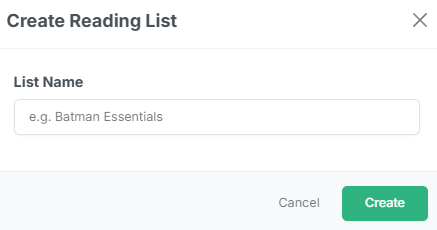{: .center-image}

Click **Create List** on the Reading Lists page, enter a title for the new list, and click **Create**. You can immediately begin adding comic issues.

### Adding Issues to a Reading List

Issues can be added through two workflows:

#### Add via Search

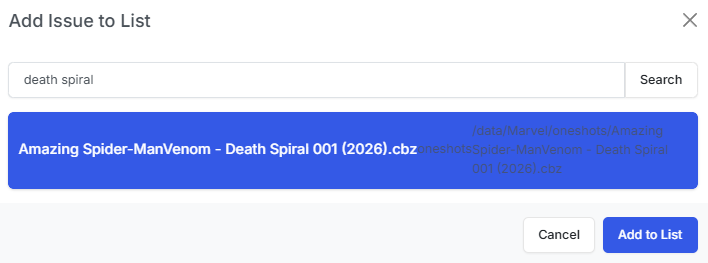{: .center-image .sixty}

Click **Add Issue** inside any reading list to open the search modal:

1. Search by title, series, or keyword across your CLU file index.
2. Select the desired issue from the results list.
3. Click **Add to List**.

#### Add via Collection Browser

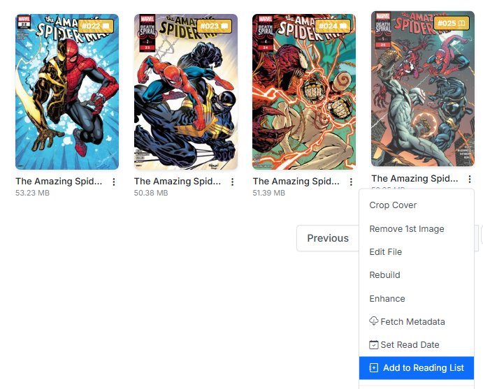{: .center-image}

From any issue card in the collection browser or Source Wall, open the <i class="bi bi-three-dots-vertical fs-2 text-icon"></i> menu and select **Add to List**. A modal will prompt you to select which reading list to add the issue to.

### Adjusting Reading Order

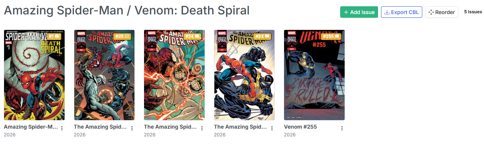{: .center-image}

Click **Reorder** in the reading list detail view to enter ordering mode:

1. The grid switches to a drag-and-drop layout.
2. Drag and reposition issue cards into your desired reading sequence.
3. Click **Save Order** to persist the new sequence.

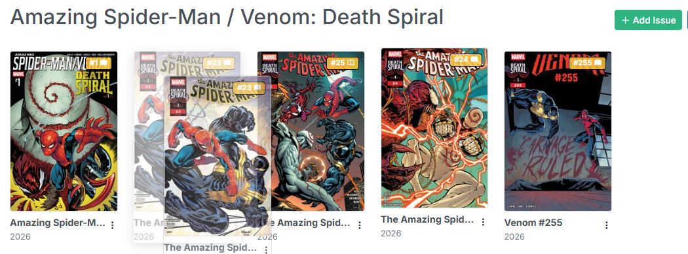{: .center-image .sixty}

### Mapping Missing Issues

For imported lists where an entry did not automatically find a matching local file, click the placeholder cover card or select **Map Issue** from the three-dot menu to link a file.

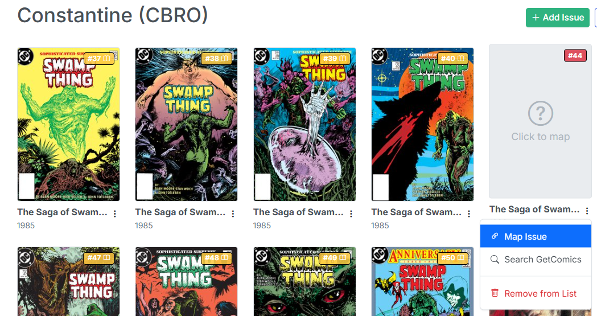{: .center-image}
/// caption
Mapping an unmatched issue to a local comic file
///

You can also search for and trigger a download for missing issues directly from the mapping dialog.

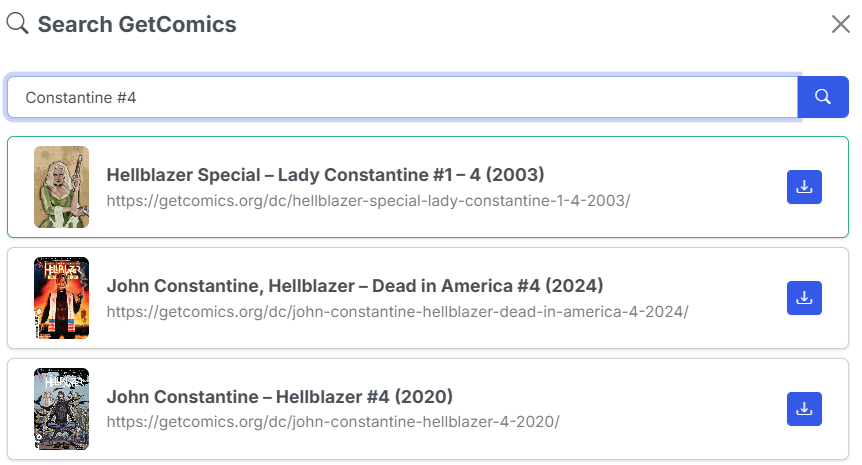{: .center-image}
/// caption
Searching for a missing issue across download sources
///

### Automatic Match Persistence

CLU automatically preserves reading list associations:

- **Follows file moves and conversions**: Renaming a file, moving it to another directory, or converting from CBR to CBZ preserves all reading list mappings.
- **Immediate gap filling**: When a new comic download arrives in your library, CLU immediately evaluates open entries on tracked reading lists and maps matching files without waiting for a re-scan.
- **Volume and year precision**: Matcher logic takes publication year and volume numbering into account to ensure different series with identical issue numbering are not confused.

### Managing Tags

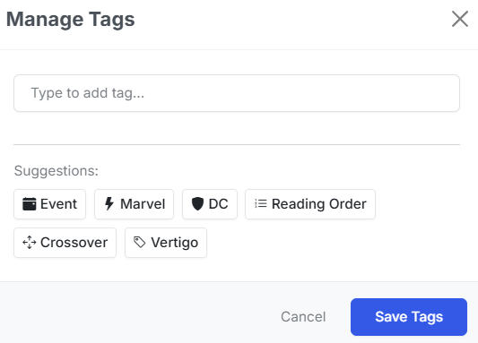{: .center-image .sixty}

Click the **Tags** <i class="bi bi-tags"></i> button on any reading list card to manage its tags:

- Type to create new tags with autocomplete suggestions from existing tags.
- Click tag badges to quickly toggle them.
- Use assigned tags to filter lists on the main Reading Lists index.

## Reading Lists on the Dashboard

### Bookmarking a List

Click the **Bookmark** button on any reading list card to add it to your personal dashboard. Bookmarks are personal to each user account and do not affect other users in multi-user installs.

### Want to Read

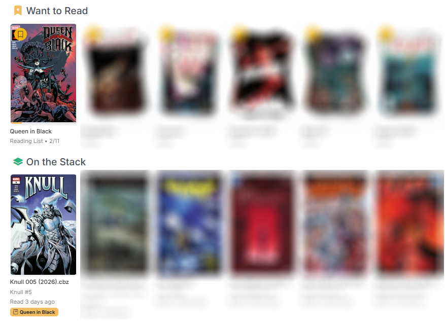{: .center-image}
/// caption
A bookmarked reading list displayed as a Want to Read card
///

Bookmarked lists appear as a card in the **Want to Read** row on your collection homepage, providing:

- A layered **cover stack** drawn from the list's issues.
- A **read / total count** badge.
- A visual **progress bar** indicating completion.
- Direct click-through access to the reading list.

### On the Stack

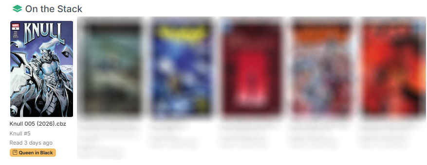{: .center-image}

Bookmarked lists feed your **On the Stack** dashboard section with their next unread issue:

- An issue is eligible for the stack if it is the first unread entry in reading order that has a matched local file.
- Unmatched missing entries are skipped, allowing you to advance through available issues.
- Each issue displays a badge indicating the source reading list.
- If a bookmarked list and an active Pull List series point to the same comic, it is deduplicated and shown once.

## Searching for Missing Issues

Clicking a missing issue in a reading list opens the multi-source search modal, allowing you to locate and queue downloads across GetComics, Usenet, and DC++, ranked according to your configured [Source Priority](../usenet/source-priority.md). Search queries automatically incorporate the release year for precise results.

## Reading Lists and Roles

In a [multi-user install](../users/index.md):

- **Readers** can browse shared reading lists, read issues, and manage their own dashboard bookmarks.
- Creating, importing, editing, deleting, mapping, reordering, syncing, and toggling **Track Wanted** are restricted to [Clerk](../users/roles.md) and Administrator roles.
