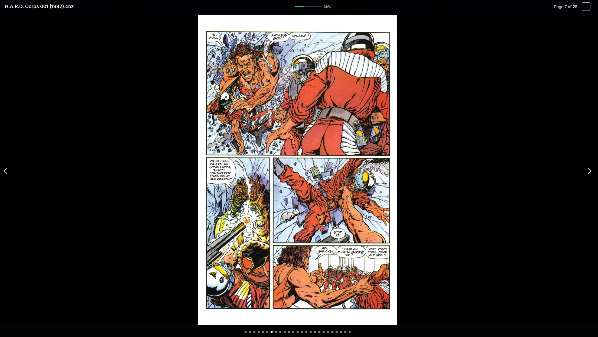
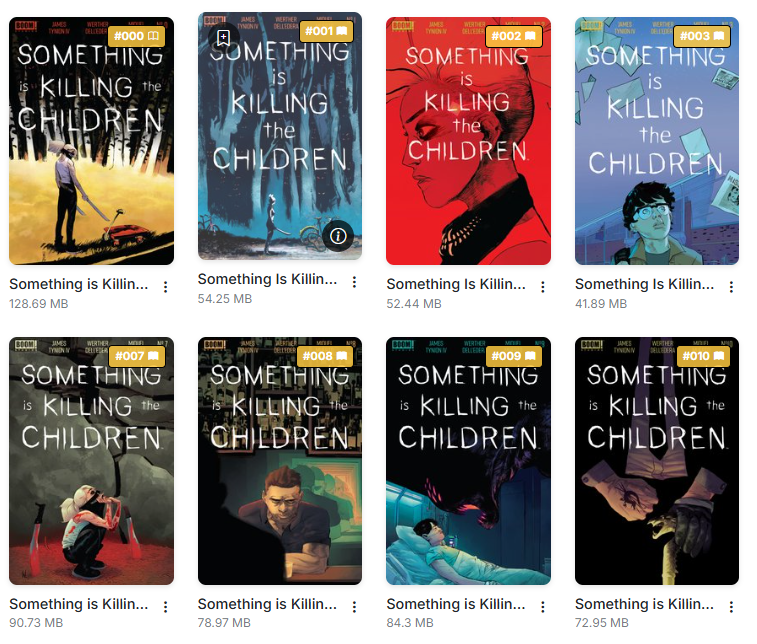

# Reading Comics

{: .center-image}
/// caption
Reading a Comic
///

When browsing your collection, click on any comic card to open it in the built-in reader modal.

## Read vs. Unread Status

{: .center-image}
/// caption
Read vs. Unread Status
///

When reading a comic, it is automatically marked as completed and added to your reading history once you pass 90% of the pages.

Completed and in-progress comics display a reading status icon <i class="bi bi-book text-primary"></i> in the corner of the cover badge next to the issue number.

## Reader Features

The reader is designed for lightweight, high-performance reading across desktop and mobile devices:

1. **Instant Loading**: Pages load on demand, pre-buffering upcoming pages in the background as you read.
2. **Responsive Layout**: Adapts automatically across desktop monitors, tablets, and mobile phones.
3. **Page Counter**: Displays the current page number alongside the total page count.
4. **Progress Bar**: Shows visual progress through the issue. Reaching 90% automatically marks the issue as read.
5. **Direct Navigation**: Use the scrubber dots along the bottom or the page selector to jump directly to any page.
6. **Toggleable Controls**: The header and footer overlay the top and bottom of the page. Tap or click anywhere on the page to toggle controls on or off. Double-click or double-tap to zoom.

### Resuming Reading

{: .center-image}
/// caption
Resume Reading
///

If you close the reader before reaching the 90% completion threshold, CLU saves your position. The next time you open the issue, a prompt offers to resume reading from that exact page or start over from page one.

You can also manually set a bookmark at any time by clicking the <i class="bi bi-bookmark text-primary"></i> icon in the reader header.

### Reading Position & History Persistence

Reading progress and bookmarks follow robust persistence rules:

- **Follows file operations**: If you rename an issue, move it to a different directory, or convert it from CBR to CBZ, your reading progress and bookmarks remain intact.
- **Autosave on exit**: Reading positions save automatically when closing the reader, switching tabs, or refreshing the browser, preventing lost progress on mobile devices.
- **Per-user privacy**: In multi-user setups, reading progress, history, and bookmarks are isolated to each user account.
