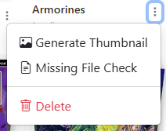
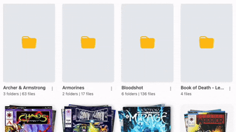

# Collection Browsing (Series)

{: .center-image}
/// caption
Example Collection Series Page
///

Opening a publisher displays all child series folders and standalone issues contained in that directory.

## Series Options

For any series folder, clicking the <i class="bi bi-three-dots-vertical fs-2 text-icon"></i> menu provides management options:

{: .center-image}
/// caption
Example Series Dropdown Menu
///

1. **Generate Thumbnail**: Generates a thumbnail for the folder based on its contents if art is missing.
2. **Missing File Check**: Checks for missing issues within the series based on the [Missing File Check](../directory-features/missing.md).
3. **Delete**: Deletes the folder and all contained files after confirmation.

### Generating Thumbnails

{: .center-image}
/// caption
Example of Generating Thumbnails
///

To generate a thumbnail for a series, select **Generate Thumbnail** from the folder menu. CLU builds an image from the folder's contents:

1. **Single-issue folders**: Uses the cover of that issue as the folder thumbnail.
2. **Multi-issue folders**: Composes art using up to the first four issues according to your selected [folder art style](../app-settings/personalization.md#folder-thumbnail-style). In the default **Fanned Stack** style, the first issue forms the front cover with subtle offset rotation.
3. **Nested folders**: Uses the lead cover from up to four child folders, with an optional folder glyph overlay (see [folder icon overlay](../app-settings/personalization.md#show-the-folder-icon-overlay)).

CLU supports four thumbnail layout styles: **Fanned Stack**, **Single Image**, **Isometric Cascade**, and **2x2 Mosaic Grid**. These can be chosen site-wide under [Personalization](../app-settings/personalization.md#folder-thumbnail-style). You can also pin an exact issue cover as the front image using **[Set as Folder Thumbnail](issues.md#set-as-folder-thumbnail)**.

### Regenerate All Thumbnails

Changing the folder art style in settings applies to newly generated art going forward. To restyle folders you already have, use **Regenerate All Thumbnails**.

On any top-level publisher folder, select **Regenerate All Thumbnails** from the <i class="bi bi-three-dots-vertical fs-2 text-icon"></i> menu to update every series folder within it. A global version covering all libraries is available on the [Personalization](../app-settings/personalization.md#regenerate-all-thumbnails) page.

Regeneration runs asynchronously in the background with live progress displayed in **Active Operations**.

!!! note "Preserves publisher art and pinned covers"
    Running this operation on a publisher restyles child series art while leaving that publisher's own custom header and cover art untouched. Any series with a [pinned issue cover](issues.md#set-as-folder-thumbnail) will preserve that chosen cover within the updated layout.

### Mark a Series as "Want to Read"

Click the <i class="bi bi-bookmark-plus fs-2 text-icon"></i> icon in the top left of the series list to add it to your **Want to Read** list. This surfaces the series in the Want to Read row on your collection homepage and in your OPDS feed.