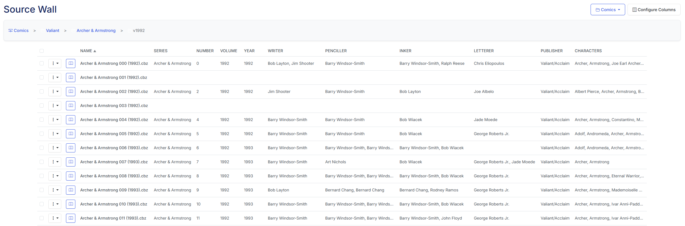
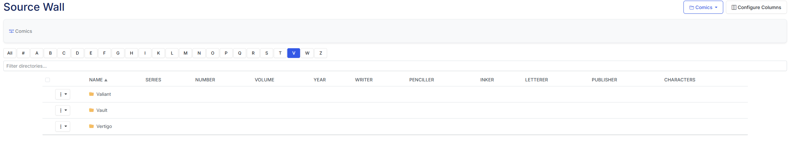
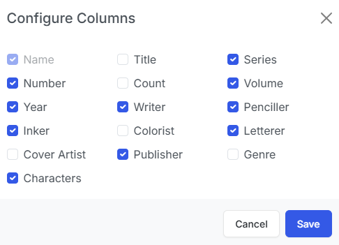
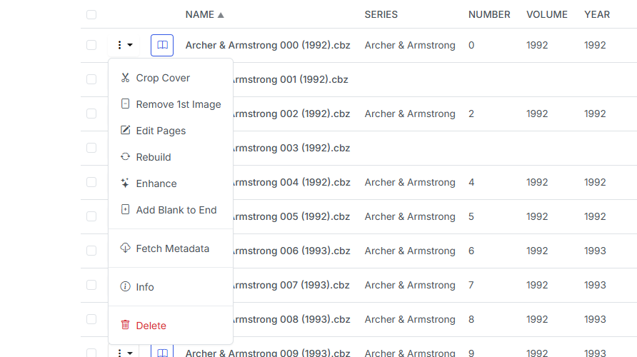

# Source Wall

/// caption
Example Source Wall
///

The Source Wall provides a tabular, spreadsheet-style view of your library with detailed metadata columns. It is designed for auditing tags, inspecting file properties, and executing file actions across your collection.

/// caption
Source Wall Publishers View
///

## Column Configuration

You can customize visible columns by clicking the <i class="bi bi-layout-three-columns fs-1 text-icon"></i> icon in the top right corner of the Source Wall view.

{: .center-image}
/// caption
Config Options
///

Use the column selector to toggle which metadata fields and technical properties appear in the table.

## Issue Actions

You can open and read any issue directly by clicking the <i class="bi bi-book fs-2 text-info"></i> icon in its row.

Click the <i class="bi bi-three-dots-vertical fs-2 text-icon"></i> menu on any row to access issue operations:

{: .center-image}
/// caption
Example Issue Dropdown Menu
///

1. **Crop Cover**: Crops the first image of the CBZ, saving the right side as the new cover and the full spread as the second image. See [Crop Cover](../single-file-features/crop.md).
2. **Remove First Image**: Removes the first image from the issue. See [Remove First Image](../single-file-features/remove.md).
3. **Edit Pages**: Unpacks the CBZ to edit or reorder pages and metadata. See [Edit File](../single-file-features/edit.md).
4. **Rebuild**: Rebuilds an improperly constructed CBZ file or converts a CBR to CBZ format. See [Rebuild](../single-file-features/rebuild.md).
5. **Enhance**: Enhances image quality across all pages in the comic. See [Enhance](../single-file-features/enhance.md).
6. **Add Blank to End**: Appends a blank `.png` file named `zzzz9999` to the end of the archive to fix two-page spread alignment in manga readers.
7. **Fetch Metadata**: Queries metadata providers to retrieve comic information and generate a `ComicInfo.xml` file. See [Get ComicInfo.xml](../file-management/comicinfo.md#get-metadata-for-a-single-issue).
8. **Info**: Displays technical metadata and the full contents of `ComicInfo.xml` (e.g., page count, resolution, archive details).
9. **Delete**: Deletes the issue from your library. See [Delete](../single-file-features/delete.md).
