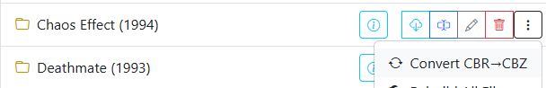

# Convert Directory

{: .center-image }

The **Convert Directory** tool batch converts all CBR and RAR comic archives within a directory into standard CBZ (ZIP) archives.

To run this tool, open the **File Manager**, click the <i class="bi fs-2 bi-three-dots-vertical text-warning"></i> menu to the right of any directory name, and select **Convert CBR $\rightarrow$ CBZ**.

This operation automatically skips any files that are already in CBZ format. If you need to re-pack or repair existing CBZ archives as well, use [Rebuild All Files](rebuild.md).

### Converting Subdirectories

By default, this feature converts only the files directly within the selected directory and does not recurse into subdirectories.

You can enable recursive processing by turning on **Enable Subdirectories for Conversion** in [File Settings](../app-settings/file-settings.md#directory-file-processing-settings).

!!! tip "Performance considerations"
    Converting high-level directories containing hundreds of archives can require significant processing time and temporary disk space. Conversions run in the background with live progress reported in the operations indicator.

## A CBR left beside its own CBZ

Upon completing a conversion, CLU validates the newly created CBZ file and deletes the source CBR or RAR archive from disk.

If you encounter duplicate pairs (`.cbr` and `.cbz` with the same name) in your folders:

- This typically indicates that an earlier conversion operation was interrupted before file cleanup completed, or that file system permissions on a network share (such as CIFS/SMB mounts) temporarily prevented source file deletion.
- Verify that the resulting `.cbz` file opens and reads correctly, and safely delete the redundant `.cbr` source file.
