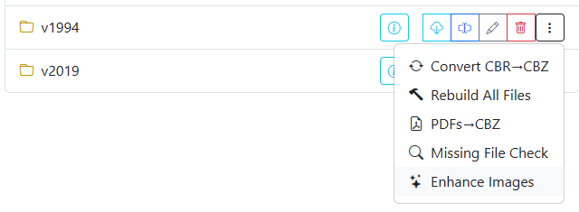

# Enhance Images

{: .center-image }

When browsing your library in the **File Manager** or **Collection**, select **Enhance Images** from the folder menu to optimize visual clarity across all comic issues in that directory.

Older digital comic releases and vintage print scans can suffer from washed-out colors, elevated black levels, and dull contrast. The **Enhance Images** tool processes all images within each CBZ archive in the directory, improving readability while preserving subtle artistic details. This operation does not traverse subdirectories.

## Visual Comparison

| Before | After |
| :---: | :---: |
|  |  |

## Enhancement Algorithm

Rather than applying a simple linear contrast adjustment — which risks blowing out paper highlights or clipping dark textures — CLU applies an intelligent modified S-curve adjustment using Python's Pillow (PIL) library.

### Modified S-Curve LUT

- **Dark Tones (< 128 brightness)**: Receives the full S-curve adjustment, deepening muddy darks into rich blacks.
- **Bright Tones (≥ 128 brightness)**: Progressively blends the original pixel values with the curve, ensuring bright backgrounds, white panels, and text balloons do not get blown out.
- **Mid-Tones**: Boosts color saturation and ink line sharpness without introducing harsh artifacts.

```python
def modified_s_curve_lut():
    lut = []
    for i in range(256):
        # Calculate base S-curve value using cosine
        s = 0.5 - 0.5 * math.cos(math.pi * (i / 255))
        s_val = 255 * s
        # Apply full curve below 128; blend smoothly with original above 128
        if i < 128:
            blend = 0.0
        else:
            blend = (i - 128) / (255 - 128)
        new_val = (1 - blend) * s_val + blend * i
        lut.append(int(round(new_val)))
    return lut
```

### Color Space Adaptability

The enhancement pipeline inspects each image's color space before applying the transformation:

- **Grayscale (`L`)**: Applies the 256-value lookup table directly to the luminance channel.
- **RGB Color (`RGB`)**: Replicates and applies the LUT across all three color channels simultaneously.
- **Alpha Transparency (`RGBA`)**: Splits color and alpha channels, applies the LUT to red, green, and blue channels, and recombines them while preserving alpha transparency intact.
