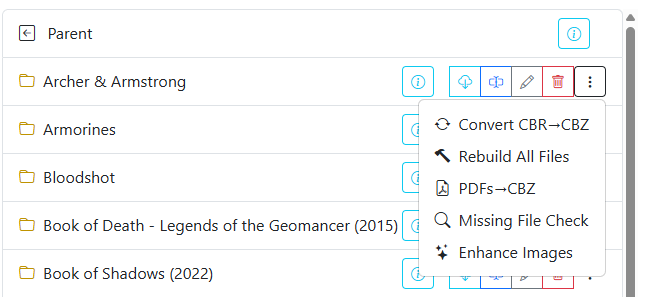

# Directory Features

{: .center-image }

Directory-based features provide batch operations across entire folders in your comic library. Instead of processing files individually, you can execute format conversions, filename cleanup, metadata updates, and sequence audits across an entire folder with a single action.

When browsing your library in the **File Manager**, directory operations are accessible via the <i class="bi fs-2 bi-three-dots-vertical text-warning"></i> menu to the right of any directory name.

## Available Directory Features

| Feature | Description | Documentation |
| --- | --- | --- |
| **Rename All Files** | Standardizes filenames, strips redundant tags, and applies custom naming schemes. | [Rename All Files](rename.md) |
| **Convert Directory** | Batch converts CBR and RAR archives into standard CBZ files. | [Convert Directory](convert.md) |
| **Rebuild All Files** | Unpacks and rebuilds all archives (CBR, RAR, CBZ) to repair corrupted structures. | [Rebuild All Files](rebuild.md) |
| **Convert PDF to CBZ** | Extracts raster pages from PDF documents and repackages them into CBZ archives. | [Convert PDF to CBZ](pdf.md) |
| **Missing Issue Check** | Scans issue number sequences to detect missing issues in a series. | [Missing Issue Check](missing.md) |
| **Enhance Images** | Applies automated contrast and curve adjustments across all pages in a folder. | [Enhance Images](enhance.md) |
| **Bulk ComicInfo Actions** | Updates or removes embedded `ComicInfo.xml` metadata across all folder files. | [Update ComicInfo.xml](update.md) |