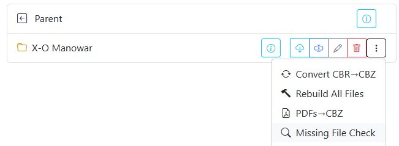
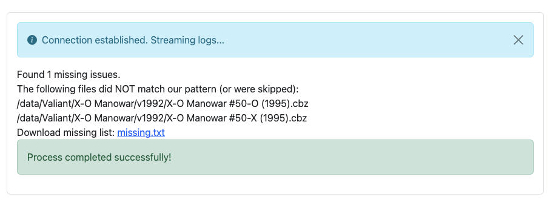
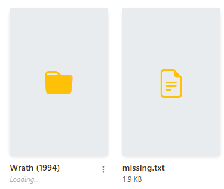
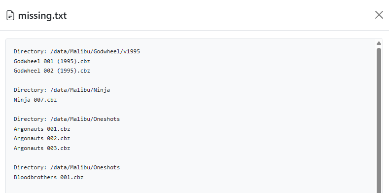

# Missing Issue Check

{: .center-image }

The **Missing Issue Check** tool scans a folder and its subdirectories to identify gaps in issue numbering sequences, generating a report file named `missing.txt`.

You can run this tool from the folder actions menu (<i class="bi fs-2 bi-three-dots-vertical text-warning"></i>) in either the **File Manager** or the **Collection** view by selecting **Missing Issue Check**.

{: .center-image }

## How Detection Works

The check evaluates numeric patterns in filenames across each directory:

- Sequences are assumed to start at issue `#1` (e.g. `01`, `001`) and progress sequentially up to the highest issue number present in that folder.
- Any gaps found between issue 1 and the highest numbered issue are recorded in the report.
- When more than 50 consecutive issues are missing (often seen when series switch to legacy numbering, e.g. jumping from issue `#70` to `#500`), the report summarizes the gap as a range:
  ```
  Series Name 071-499 (1998) [Total missing: 429]
  ```

Sample `missing.txt` output:

```
Directory: /data/Comics/Eternal Warrior/v1992
Eternal Warrior 008 (1992).cbz

Directory: /data/Comics/Harbinger/v1992
Harbinger 011 (1992).cbz

Directory: /data/Comics/X-O Manowar/v2012
X-O Manowar 005 (2012).cbz
X-O Manowar 006 (2012).cbz
X-O Manowar 007 (2012).cbz
```

## Ignored Terms and File Rules

To avoid false-positive gap reports caused by annuals, preview editions, or trade paperbacks, customize ignored terms and file patterns in [System Settings](../app-settings/system-settings.md#missing-issue-configuration) under **Missing Issue Configuration**.

## Accessing `missing.txt`

The resulting `missing.txt` report is saved directly inside the scanned directory.

{: .center-image }

You can open and read `missing.txt` directly within the CLU interface by clicking the file card in the browser:

{: .center-image }
