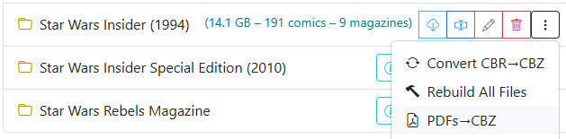

# Convert PDF to CBZ

{: .center-image }

The **Convert PDF to CBZ** tool extracts raster images from PDF documents in a directory and packages them into standard CBZ archives. This makes digital comic magazines, art books, and graphic novels stored in PDF format fully compatible with comic readers, OPDS feeds, and metadata taggers.

## How to Run

1. Open the **File Manager** and locate the directory containing your PDF files.
2. Click the <i class="bi fs-2 bi-three-dots-vertical text-warning"></i> menu to the right of the directory name.
3. Select **Convert PDF to CBZ** from the dropdown menu.

## Conversion Process

- **Page Extraction**: Each page of the PDF document is rendered and extracted into a full-resolution image.
- **Archive Creation**: Extracted pages are organized with standard zero-padded numbering (e.g. `001.jpg`, `002.jpg`) and compressed into a `.cbz` archive matching the source document's base filename.
- **Preserves Original Files**: The conversion process verifies the newly created `.cbz` archive before finishing.

Once converted to CBZ, the issues can be read in the built-in [Comic Reader](../collection/reading.md), enhanced with [Image Enhancement](enhance.md), or tagged with metadata using [Fetch Metadata](../file-management/comicinfo.md).
