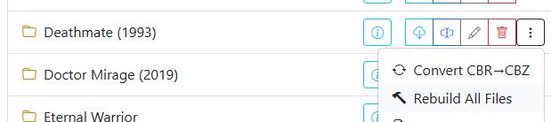

# Rebuild All Files

{: .center-image }

The **Rebuild All Files** tool unpacks, validates, and repackages all comic archives in a directory into standardized CBZ format.

While [Convert Directory](convert.md) only processes CBR and RAR files and skips existing CBZ archives, **Rebuild All Files** processes every archive in the directory:

1. **Converts RAR / CBR files** into clean CBZ format.
2. **Re-packs existing CBZ files**, restructuring internal folder hierarchies, stripping non-image junk files, and repairing damaged zip headers.

Rebuilding fixes common indexing failures and thumbnail rendering errors encountered in media servers and comic readers.

## Archive Format Recovery

Archives are occasionally misnamed — for instance, a RAR archive incorrectly labeled with a `.cbz` extension. During rebuild operations, CLU inspects the archive's actual file headers. If standard ZIP extraction fails, CLU automatically tests RAR extraction, recovers the embedded page images, and repacks them into a true, valid CBZ archive.

To convert PDF documents into CBZ format, see [Convert PDF to CBZ](pdf.md).
