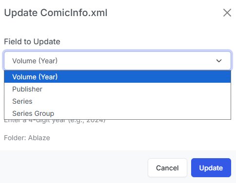
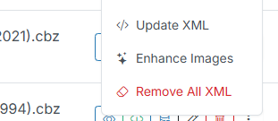

# Bulk Actions on ComicInfo.xml

CLU lets you manage your `ComicInfo.xml` metadata in bulk with two primary operations: **Update** and **Delete**.

## Bulk Update ComicInfo

{: .center-image }

This tool allows you to batch-update key metadata values in the `ComicInfo.xml` file of each CBZ archive in a directory.

Four fields can be updated simultaneously:

- **Series**: Updates the Series Name across all files in the directory.
- **Issue**: Updates the Issue Number across all files in the directory.
- **Volume**: Updates the Volume / Year field across all files in the directory.
- **Publisher**: Updates the Publisher name across all files in the directory.

## Bulk Delete ComicInfo

This tool strips the embedded `ComicInfo.xml` file from multiple archives at once. It can be executed from either the Library View or the File Browser:

### Library View (Multi-Select)

{: .center-image }

In the Library grid, hold CTRL or SHIFT while clicking files to select multiple items. Once two or more files are selected, the **Bulk Actions Bar** appears at the bottom of the screen. Click **Remove XML** to remove the metadata file from every selected archive.

### File Browser (Folder Menu)

{: .center-image }

When navigating via the File Browser, click the <i class="bi fs-2 bi-three-dots-vertical text-warning"></i> menu on any folder and select **Remove All XML**. CLU will remove the `ComicInfo.xml` file from all comic archives contained within that directory.

### Job Queue Behavior

Bulk metadata deletions run on the shared file job queue:

- If another file operation (such as batch renaming or metadata scraping) is currently running, the job is queued and begins automatically when preceding jobs finish.
- Files that do not contain a `ComicInfo.xml` are recorded as skipped rather than errors.
- A corrupted or locked archive will not halt processing for the remainder of the files in the batch.