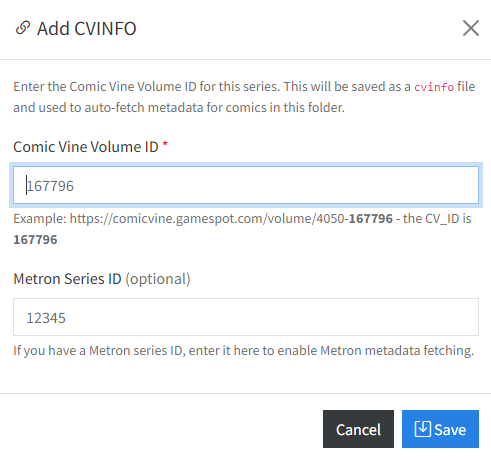
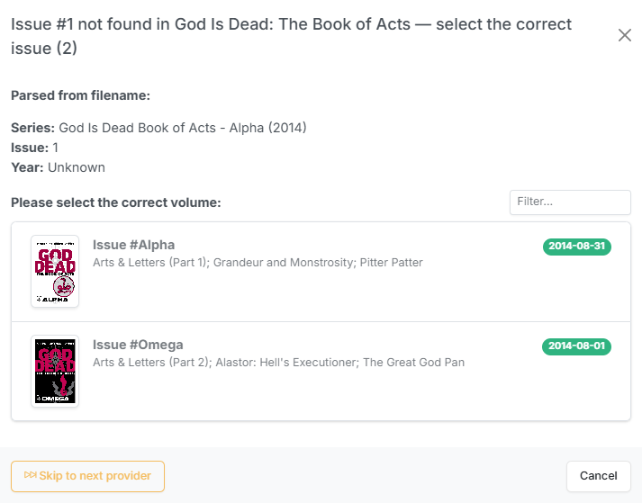

# Adding Metadata

CLU supports multiple comic metadata providers that can be configured per library. You can search across multiple databases simultaneously in your preferred priority order when scraping and embedding metadata.

## Overview

CLU queries configured metadata providers to generate standard `ComicInfo.xml` metadata inside your comic archives. Providers can be assigned per library with configurable priority ordering — CLU queries providers in sequence and applies tags from the first provider that returns a valid match.

| Provider | Status | Description |
| --- | --- | --- |
| [Metron](https://metron.cloud) | <i class="bi bi-check-circle-fill text-success"></i> | Metron Comic Book Database |
| [ComicVine](https://comicvine.gamespot.com/) | <i class="bi bi-check-circle-fill text-success"></i> | ComicVine Cloud Database |
| ComicVine (Local DB) | <i class="bi bi-info-circle-fill text-info"></i> | Local ComicVine SQLite database (requires [local setup](../local-databases/comicvine.md)) |
| [GCD API](https://github.com/GrandComicsDatabase/gcd-django/wiki/API) | <i class="bi bi-check-circle-fill text-success"></i> | Grand Comics Database API |
| [GCD](https://www.comics.org/) | <i class="bi bi-info-circle-fill text-info"></i> | Grand Comics Database (requires [local setup](../local-databases/gcd.md)) |
| MangaDex | <i class="bi bi-check-circle-fill text-success"></i> | MangaDex Manga Database |
| MangaUpdates | <i class="bi bi-check-circle-fill text-success"></i> | MangaUpdates Database |
| Bedetheque | <i class="bi bi-info-circle-fill text-warning"></i> | European Comic Database (Planned) |

If you have enabled a [Local Metadata Database](../local-databases/index.md), an additional search option appears in the File Manager to query your local SQLite cache.

## Configuration

Navigate to **[Settings > Metadata Providers](../app-settings/metadata.md)** to configure provider API keys, test connections, and adjust priority ordering. Save and test each provider before use — a green checkmark confirms successful API connectivity.

Make sure to enable each provider for the specific library you wish to query. See [Assign Metadata Providers to Libraries](../app-settings/metadata.md#assign-metadata-providers-to-libraries) for details.

## CVINFO File and Creation

Comic series folders can store a `.cvinfo` sidecar file containing ComicVine and Metron series IDs. This provides persistent series identification, ensuring future issues placed in that folder match immediately without requiring ambiguous text searches.

To create or edit a sidecar file, open the series folder in the File Manager and click the <i class="bi bi-link-45deg text-primary"></i> **Add CVINFO** button.

{: .center-image }

Enter the ComicVine ID or Metron ID for the series. CLU also creates this sidecar automatically when subscribing to a series via the [Pull List](../pull-list/series.md) or retrieving metadata for a folder.

### Automated Metadata on File Move

When moving files, CLU can automatically apply metadata if configured in [File Settings](../app-settings/file-settings.md):

- A valid `cvinfo` sidecar exists in the destination directory.
- The file does not currently contain a `ComicInfo.xml` file (or existing metadata was generated from basic store data and needs enrichment).

### Automated Renaming on Metadata Retrieval

When metadata is added to an archive, CLU can automatically rename the file to match your configured [Custom Rename Pattern](../app-settings/file-settings.md#custom-naming-settings) using verified series, volume, and issue tags.

## Handling Unmatched Issue Numbers

When scraping metadata, CLU matches issues against the identified volume using exact issue numbering. If an issue uses non-standard numbering (such as decimal variants like `1.MU`, letters like `13A`, or differing numbering conventions), CLU opens an interactive issue picker displaying all issues from that volume:

{: .center-image }
/// caption
Issue picker displaying available volume entries
///

Select the correct issue card to apply the metadata tags.

### Batch Folder Processing

During automated folder runs, files with unmatched issue numbers are collected in the background rather than interrupting the batch. Once the main sweep finishes, you can step through and resolve any flagged near-misses sequentially.

### Match Precedence

Exact matches from any configured provider always take priority. The manual issue picker is only presented after the entire provider cascade has been queried without an exact issue match.
