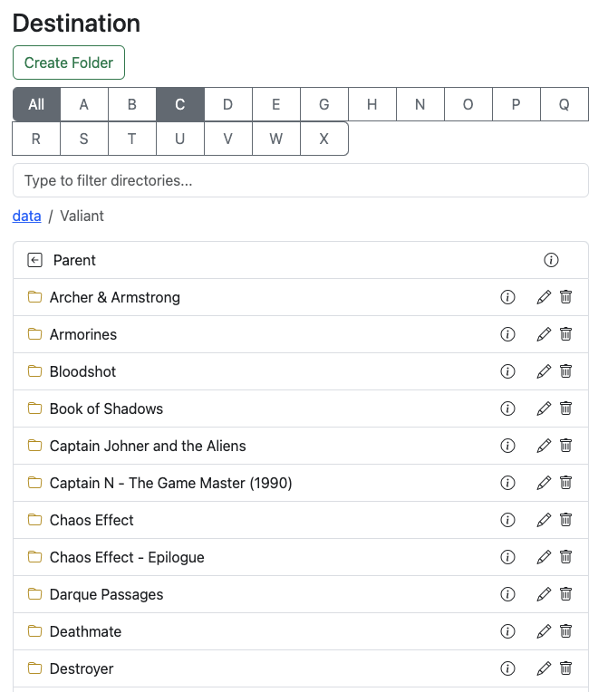
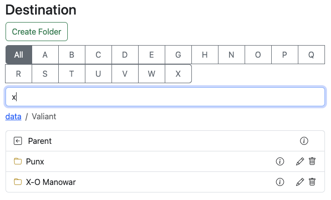
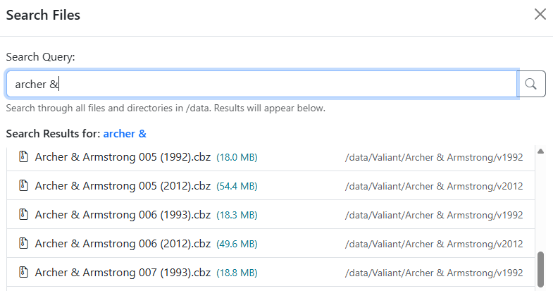
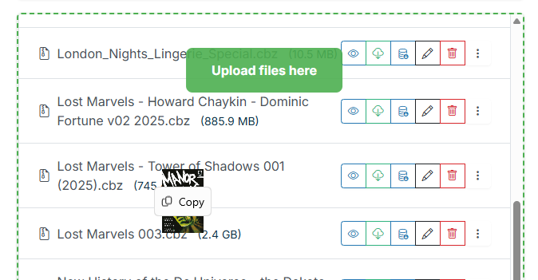
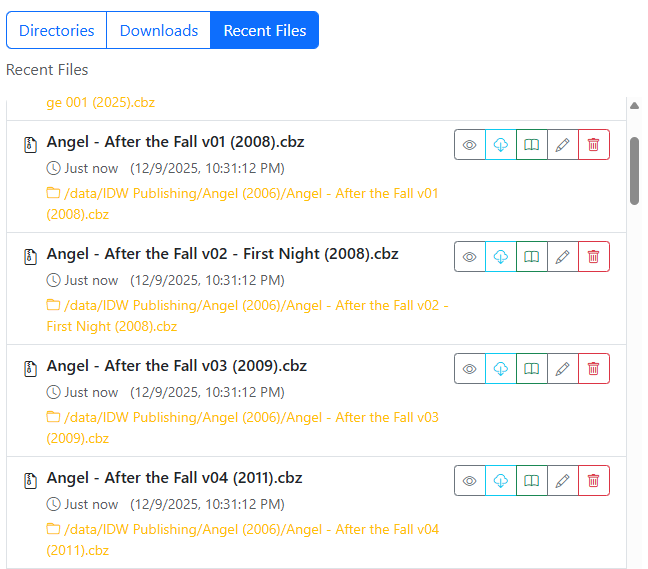
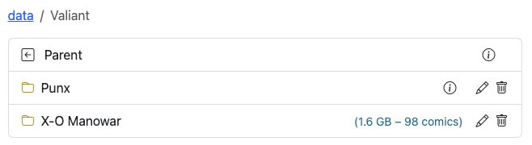
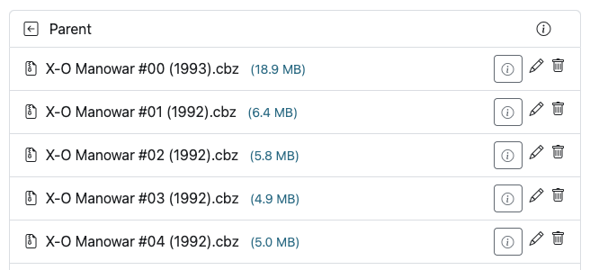
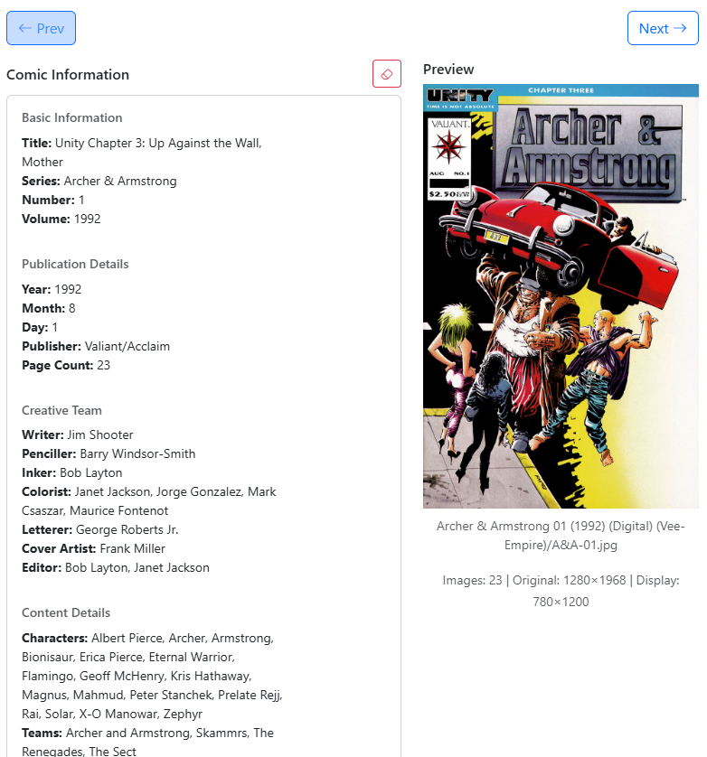
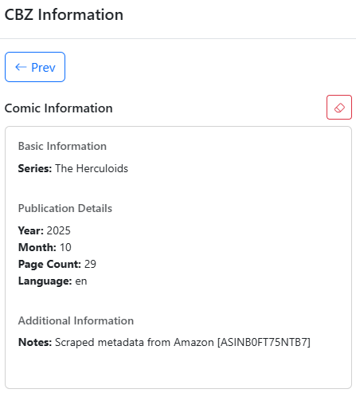

# Additional Features

The File Manager includes several built-in tools to help inspect, search, and manage your collection efficiently.

### Directory Filtering

For directories containing more than 25 folders, an interactive filter bar appears at the top of the list. Typing into the field immediately filters the visible folder list in real time.

| Filtering Large Directory | Filtered Results |
| :---: | :---: |
|  |  |

### Search

Use the search bar to locate specific comic titles, issue numbers, or series across your library storage.

{: .center-image }

When CLU starts, all files and folders are indexed into the local database for rapid query response. When files or folders are moved or renamed, the database index updates automatically.

See [File Index Management](../app-settings/file-settings.md) for details on re-indexing. Searches span your entire library, excluding any temporary folders configured in [Folder Monitoring](../folder-monitoring/index.md).

### Upload Files

{: .center-image }

You can upload comic files directly to your server by dragging and dropping them from your computer into either the **Source** or **Destination** panel of the File Manager.

### Recent Files

Click **Recent Files** to view the last 100 comic files added or moved within your collection. This provides a quick way to review newly acquired downloads or recently processed files.

{: .center-image }

### File & Folder Sizes

To check folder metrics without slowing down list rendering, click the **info icon** next to any folder. CLU scans the directory on demand and returns the total file count and disk usage.

{: .center-image }

When browsing files, individual file sizes are displayed alongside each issue, making it easy to compare file editions and identify higher-resolution scans.

{: .center-image }

### View Cover, Metadata, and ComicInfo.xml

Click the **info icon** next to any comic file to open the inspector modal. This window displays the cover image, file technical properties, and any embedded `ComicInfo.xml` metadata.

{: .center-image }

Use the `<- Prev` and `Next ->` buttons to browse through adjacent issues in the folder.

If an issue contains invalid or outdated `ComicInfo.xml` data, click the <i class="bi bi-eraser fs-2 text-danger"></i> icon to clear the metadata. Upon confirmation, CLU unpacks the archive, removes the XML file, and repacks the CBZ.

{: .center-image }

### Want to Read

Select **Want to Read** from the actions menu on any file or folder to flag it for your personal reading list. Flagged items surface in the **Want to Read** carousel on your collection dashboard. In multi-user installations, this flag is personal to your user account.

### Add to Pull List

Select **Add to Pull List** from any series folder's action menu to subscribe to that series.

This runs the same identification and mapping engine used by [Scan Library](../pull-list/automap.md), but scoped to that single folder. Series sidecar files are backfilled, issue checklists are synchronized, and missing counts update in the background.

#### Outcomes

| Outcome | Meaning | Recommended Action |
| --- | --- | --- |
| `already_mapped` | The folder is already mapped to an active series on your Pull List. | No action required. |
| `applied` | The series was identified and mapped. Issues sync in the background. | No action required. View the series in your [Pull List](../pull-list/pull-list.md). |
| `needs_match` | No matching sidecar (`series.json` or `.cvinfo`) was found. | A search picker opens allowing you to search and select the correct series. |
| `conflict` | The series is already mapped to a different folder. | CLU reports the existing path. Verify which folder is correct on the [Series page](../pull-list/series.md). |
| `failed` | The mapping operation could not complete. | Check [App Logs](../app-settings/logs.md) for details. |

!!! info "Folder Scope"
    - Folders must reside within a configured [library path](../app-settings/libraries.md).
    - Top-level root folders (representing publishers) cannot be mapped directly to a single series.
