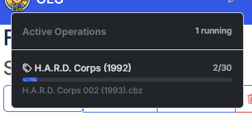
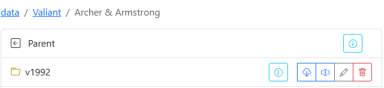
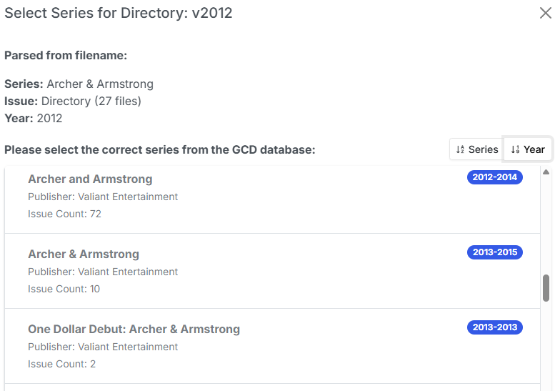
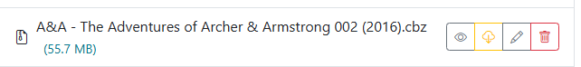

# Generate ComicInfo.xml

Depending on your configured metadata providers and whether you are processing a single file or an entire folder, CLU uses structured search hierarchies to find and apply comic metadata.

## Get Metadata for All Comics in a Folder

To fetch metadata and embed a `ComicInfo.xml` file across all issues in a folder, click the <i class="bi bi-cloud-download fs-2 text-success"></i> **Fetch Metadata for All Comics in Folder** button.

CLU queries configured providers using the following search hierarchy:

1. **`{Series Name} ({Year})`**: Uses the series name and publication year extracted from the folder structure to find an exact volume match.
2. **`{Series Name}`**: If no exact year match is found, queries for the exact series title.
3. **`% {Series Name} %`**: If no exact title match is found, performs fuzzy keyword matching across provider records.

### Folder Structure Examples

#### Series Name (Year)

{: .center-image }

Searching for a structured folder like `H.A.R.D. Corps (1992)` matches the series and publication year directly, applying metadata tags across all issues. Any issues already containing valid metadata are skipped.

Progress is displayed in a toast notification and updates in the top navigation header, allowing you to browse elsewhere while scraping continues in the background.

{: .center-image }

#### Nested Volume Folders: Series Name \ v(Year)

{: .center-image }

When managing multi-volume series organized into subfolders (e.g. `Archer & Armstrong/v1992`), CLU combines the parent directory name with the volume year to query the provider for `Archer & Armstrong (1992)`.

If multiple potential volumes match (e.g. `Archer & Armstrong (2012)`), an interactive selection modal displays candidate series along with issue counts and date ranges:

{: .center-image }

Select the correct series entry to begin scraping and writing metadata.

### Get metadata for a single issue

When fetching metadata for an individual issue, CLU applies a targeted search hierarchy:

1. **`{Series Name} {Year} {Issue Number}`**: Attempts to identify the exact volume and issue number directly.
2. **`{Series Name} {Year}`**: Locates the series volume, then searches for the specific issue number within it.
3. **`% {Series Name} %`**: Performs a keyword search across series titles, displays candidate matches, and matches the issue upon selection.

{: .center-image }

Select the matching volume and issue card to generate and write the `ComicInfo.xml` tag file.

## GCD API Considerations

When utilizing the Grand Comics Database (GCD) via its API, keep the following characteristics in mind:

- **Language Filtering**: GCD catalogs international comics across numerous languages. If a search yields multiple foreign editions, use the language filter dropdown in the results modal to isolate your preferred language.
- **Result Details**: Unlike ComicVine and Metron, basic GCD API search results do not always return cover art previews or publisher summaries. These fields populate once an issue is selected and downloaded.