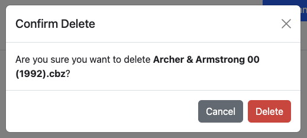
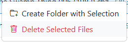
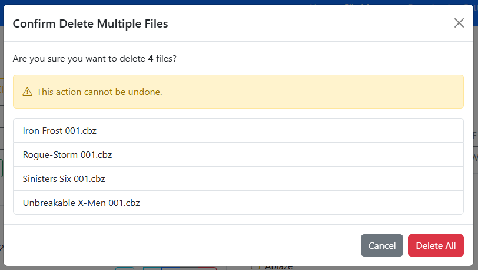

# Delete

CLU allows you to delete individual files, entire directories, or multi-selected batches from the File Manager and Collection views.

## Deleting Files

To delete an individual comic file:

1. Click the :wastebasket: (Trash) icon on the file row or select **Delete** from its action menu.
2. A confirmation modal appears showing the filename and path.

{: .center-image }

3. Click **Delete** to confirm. The file is removed from your active library.

## Deleting Directories

To delete an entire directory, select **Delete** from the folder's action menu.

!!! warning "Recursive Deletion"
    Deleting a directory removes the folder and all files and subdirectories contained within it. You will be prompted to confirm the deletion before any files are touched.

## Deleting Multiple Files

You can delete multiple files simultaneously:

1. Hold **CTRL** (or **CMD**) to select specific files, or **SHIFT** to select a continuous range of files.

{: .center-image }

2. Right-click any selected file and choose **Delete Selected Files**.

{: .center-image }

3. A confirmation modal lists all targeted files:

{: .center-image }

4. Click **Delete All** to process the batch deletion.

## Soft Delete & The Trash Can

To protect against accidental deletions and provide a safety net for automated operations, CLU includes a configurable **Trash Can** system:

- **Staging location**: When enabled, deleted files are moved to a temporary staging folder (`/cache/trash` by default) rather than being permanently destroyed on disk.
- **Automated file replacements**: When resolving duplicate comics or using **[Find a replacement](../problem-files/replacing-a-file.md)** for a damaged file, the replaced file is routed to the trash, ensuring you can revert if needed.
- **Automatic eviction**: In [File Settings](../app-settings/file-settings.md#trash-can), you can configure the **Max Trash Size (MB)**. When accumulated files exceed this threshold, the oldest items are automatically pruned.
- **Restoring files**: Trashed files retain metadata pointing to their original directory path, allowing you to restore them directly back into your library if deleted by mistake.

If the Trash Can is disabled in settings, deletions are immediate and permanent.
