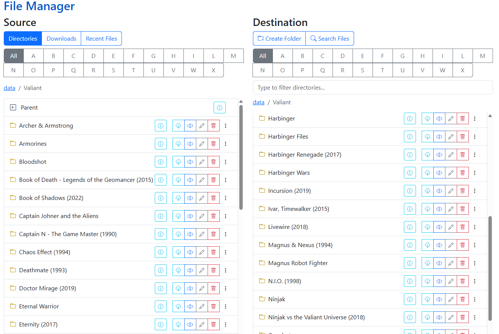

# File Management

{: .center-image }

CLU includes a dual-pane, real-time File Manager designed for managing comic files and directories directly within your browser. You can organize folders, rename issues, split collections, manage embedded metadata, and safely trash unwanted files through an intuitive drag-and-drop interface.

!!! info "Real-Time File System Access"
    The File Manager reads and interacts directly with your storage file system rather than relying exclusively on cached database records. Actions performed here are reflected immediately on disk.

## File Management Tools

| Feature | Description | Documentation |
| --- | --- | --- |
| **Move** | Drag and drop files and folders between Source and Destination panels, or bundle selections into new folders. | [Move](move.md) |
| **Rename** | Rename individual files inline, remove or replace text across filenames, or standardize series names. | [Rename](rename.md) |
| **Split File** | Deconstruct bundled multi-issue CBZ archives into standalone, single-issue CBZ files. | [Split File](split.md) |
| **Delete & Trash** | Safely remove files and folders with optional soft-delete protection via the Trash Can. | [Delete](delete.md) |
| **Additional Tools** | Fast directory filtering, global search, recent file history, size inspections, and cover previews. | [Additional Features](additional.md) |
| **Adding Metadata** | Scrape metadata across providers (Metron, ComicVine, GCD, MangaDex) and generate sidecars. | [Adding Metadata](add-metadata.md) |
| **ComicInfo.xml Options** | Understand search hierarchies, volume matching, and ComicInfo.xml generation. | [ComicInfo.xml Options](comicinfo.md) |