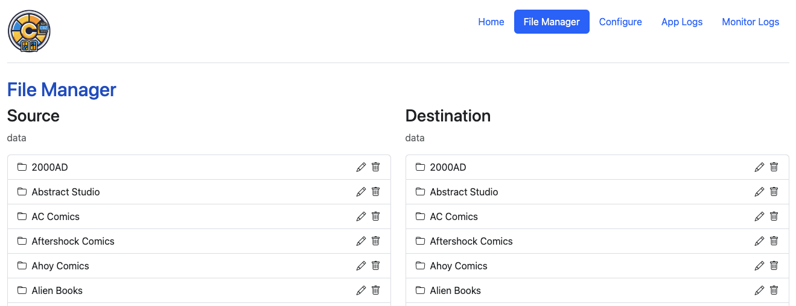
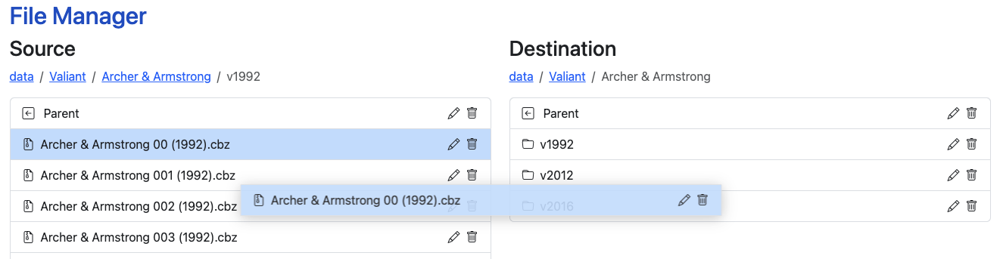
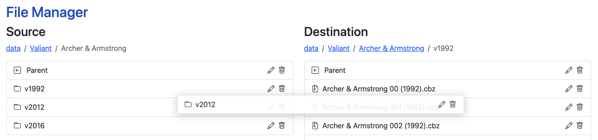
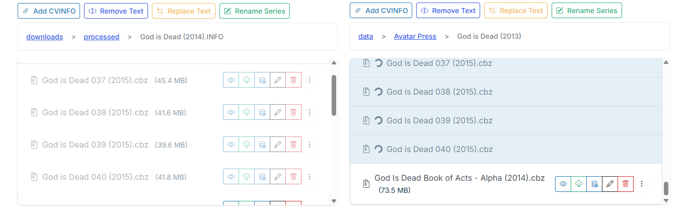
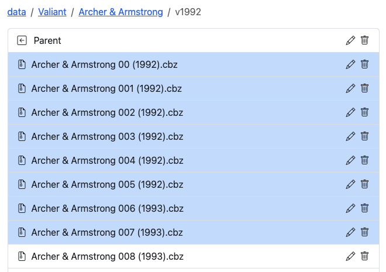
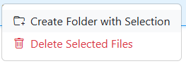
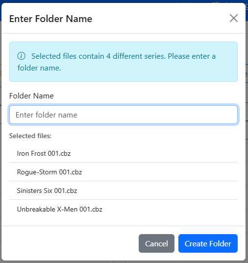

# Move

{: .center-image }
/// caption
Dual-Pane File Manager Interface
///

When the File Manager loads, it displays a dual-pane view of your storage directory in both the **Source** (left) and **Destination** (right) panels.

## Moving Files and Directories

The dual-pane interface allows drag-and-drop transfers in either direction (Source $\rightarrow$ Destination or Destination $\rightarrow$ Source).

### Moving Files

{: .center-image }

Navigate to the target file in one panel, then click and drag it to the desired directory in the opposing panel.

### Moving Directories

Navigate to the directory you wish to move, then click and drag it into its new parent folder in the opposite panel.

{: .center-image }

When moving large directories or high volumes of files, progress is reported live in the top navigation bar's **Action Items** indicator, allowing you to navigate away while the transfer completes in the background.

{: .center-image }

## Multi-Item Selection

You can select multiple files or directories simultaneously:

- Hold **SHIFT** while clicking to select a contiguous range of items.
- Hold **CTRL** (or **CMD** on macOS) while clicking to toggle individual items.

{: .center-image }

Once items are selected, you can drag the entire group to a new location at once.

## Create Folder from Files

When multiple comic files are selected, right-click to open the context menu and choose **Create Folder with Selection**:

{: .center-image }

- **Automatic series detection**: If all selected files share an identical detected series name, the new folder automatically defaults to that series title.
- **Custom folder name**: If selected files originate from different series or lack common naming, a prompt asks you to enter the desired folder name.

{: .center-image }

Click **Create Folder** to create the directory and automatically move the selected files into it.
