# Rename

CLU provides several renaming workflows in the File Manager, ranging from quick inline edits to batch string replacements and series-wide standardization.

## Rename Single Files

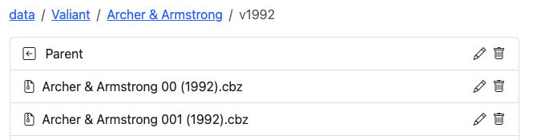

To rename an individual file or folder, hover over the item and click the :pencil2: (pencil) icon. The name turns into an active text field.

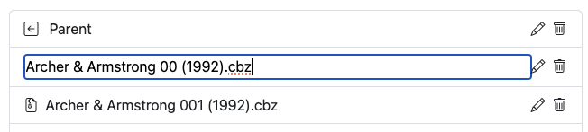

Enter the new name and press `ENTER` to save the change immediately to disk.

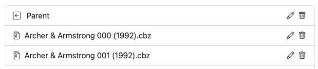

## Rename All Files in a Directory

In any directory listing, click the <i class="bi bi-input-cursor-text text-info fs-2"></i> button to execute automated batch cleaning across all comic archives in that directory:

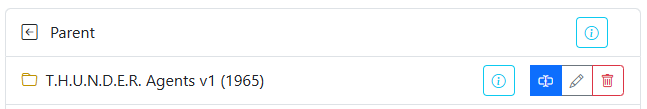{: .center-image }

This runs the automated cleaning and formatting engine detailed in [Rename All Files](../directory-features/rename.md). Batch renames run on the shared file job queue, executing safely behind any active metadata tagging or XML removal jobs.

## Remove Text from Files

To remove specific characters or substrings (such as unwanted scanner tags or volume markers like `" v01"`) across all files in a directory, click **Remove Text from Filenames**:

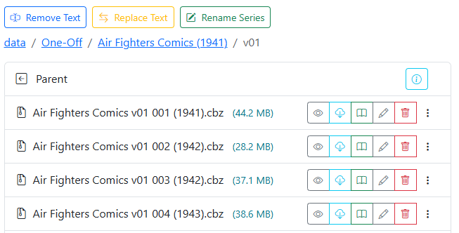{: .center-image }

1. Enter the exact text you want removed (including leading or trailing spaces if applicable).
2. Click **Preview** to review the proposed filename transformations before applying changes.

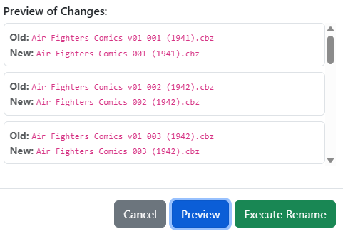{: .center-image }

3. Click **Execute Rename** to apply the changes to disk. A summary modal confirms the number of files updated.

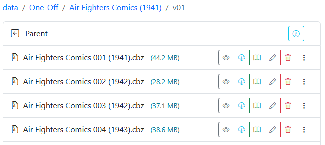{: .center-image }

## Replace Text in Filenames

To substitute one string for another across all files in a folder (for example, correcting `"Saga of the Swamp Thing"` to `"The Saga of the Swamp Thing"`), click **Replace Text**:

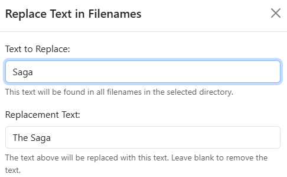{: .center-image }

1. Enter the target text to find and the replacement text.
2. Click **Preview** to inspect the before and after comparisons.

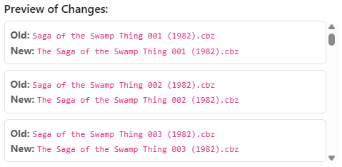{: .center-image }

3. Click **Execute Rename** to process the changes.

{: .center-image }

## Rename Series

If an entire folder of files has an incorrect, truncated, or inconsistent series prefix, click **Rename Series**. This operation replaces the series name across all files in the directory while preserving the existing `{issue}` and `{year}` values.

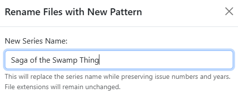{: .center-image }

1. Enter the desired series title.
2. Click **Preview** to verify how the new series name pairs with existing issue numbers and years.

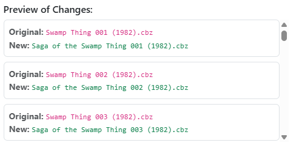{: .center-image }

3. Click **Execute Rename** to finalize the batch update.
