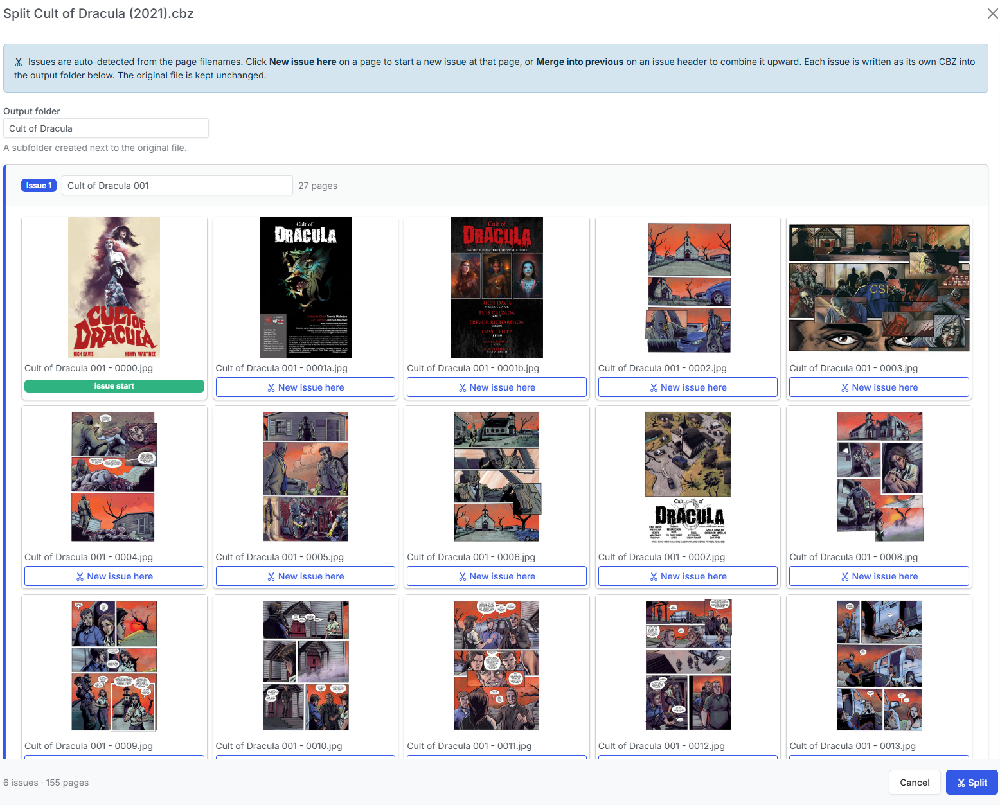
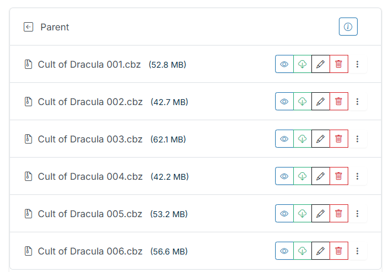

# Split File

The **Split File** tool allows you to deconstruct omnibus archives, digital trade paperbacks, or multi-issue collections into individual, single-issue CBZ archives. This ensures each issue can be indexed, read, and matched individually within your library.

!!! note "Format Support"
    Split File operates on **CBZ archives**. To split a CBR file, first convert or rebuild it as a CBZ using [Convert Directory](../directory-features/convert.md) or [Single File Rebuild](../single-file-features/rebuild.md).

## How to Split an Archive

1. In the **File Manager**, locate the multi-issue CBZ, open the per-file dropdown menu, and select **Split File**.
2. CLU unpacks the archive in memory and automatically analyzes page image filenames (such as `Series 003 - 0001.jpg`) to detect issue boundaries.
3. The interface opens an interactive page grid with detected groups:

{: .center-image }

Within this editor, you can:

- **Adjust boundaries**: Move demarcation lines to set exactly where one issue ends and the next starts.
- **Merge or add groups**: Combine erroneously split pages or manually insert boundaries that automated detection missed.
- **Set titles**: Rename each detected issue prior to generating the new files.

4. Once the groupings and issue names are set, click **Commit**. CLU generates clean, image-only CBZ files for each issue and saves them into a new series subfolder.

{: .center-image }

## File Safety

!!! warning "Original File Preserved"
    Split File does not alter or overwrite the source archive. It writes separate new CBZ archives into a new series subfolder. You can inspect the resulting issues and choose whether to archive or delete the original source file.
