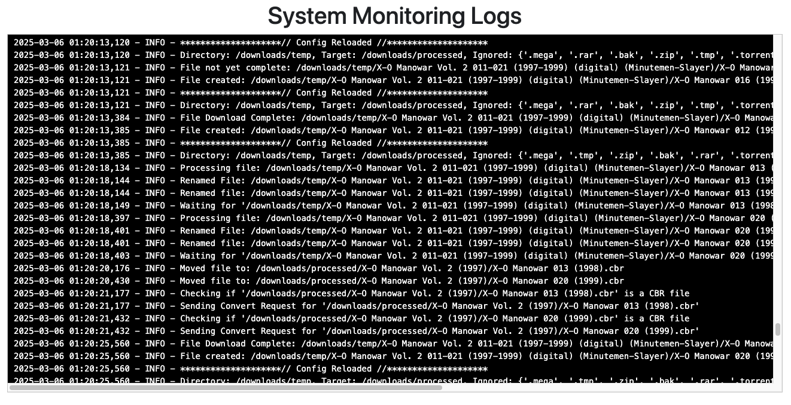

# Monitoring Logs

When Folder Monitoring is enabled, a dedicated **Monitor Logs** link is available in the top navigation bar.

{: .center-image }
/// caption
Monitor Logs in Navigation
///

The Monitor Logs view displays real-time activity for files moving through the automated ingestion pipeline.

{: .center-image }
/// caption
Folder Monitoring Live Log View
///

## Log Message Types

The monitoring log details each stage of automated file ingestion:

- **Config Reloaded**: The monitoring daemon checks for configuration changes and reloads dynamically without requiring a container restart.
- **Processing File**: Identifies the specific file currently undergoing evaluation in the WATCH directory.
- **Waiting For**: Indicates that a file is actively being written or downloaded. The monitor pauses until the file size stabilizes.
- **Renamed**: Displays the original filename alongside the newly formatted name produced by the renaming engine.
- **Moved File**: Reports the transfer path as processed files move from the WATCH directory to the TARGET directory.
- **Checking If**: Inspects the internal file structure and extension to determine if format conversion (e.g. CBR $\rightarrow$ CBZ) is needed.
- **Sending Convert Request**: Dispatches the file to the conversion worker and logs the outcome upon completion.

For general application errors and database maintenance events, refer to the main [App Logs](../app-settings/logs.md) page.
