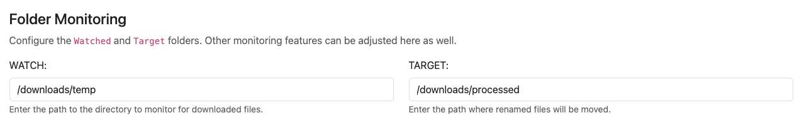

# Monitoring Setup

Folder Monitoring runs as an isolated background process to ensure continuous file processing without degrading web interface responsiveness.

## Docker Compose Configuration

To enable folder monitoring, ensure your `docker-compose.yaml` mounts a secondary volume for incoming files and sets the `MONITOR=yes` environment flag:

```yaml linenums="1"
version: '3.9'
services:
    comic-utils:
        image: allaboutduncan/comic-utils-web:latest
        container_name: clu
        logging:
            driver: "json-file"
            options:
                max-size: '20m'
                max-file: '3'
        restart: always
        ports:
            - '5577:5577'
        volumes:
            - "/path/to/local/config:/config"
            - "/path/to/local/cache:/cache"
            # Main comic library (must be mapped to /data)
            - "/e/Comics:/data"
            # Secondary volume for incoming downloads
            - "/f/Downloads:/downloads"
        environment:
            - FLASK_ENV=production
            # Enable folder monitoring background process
            - MONITOR=yes
```

Key configuration points:

- **Secondary Volume Mount** (e.g. `"/f/Downloads:/downloads"`): Mounts your download client's destination directory into the container.
- **`MONITOR=yes`**: Starts the dedicated background monitoring daemon inside the container.

If you installed CLU without monitoring enabled, update your `docker-compose.yaml` with these values and restart the container (`docker compose up -d`).

## Directory Configuration (WATCH & TARGET)

Once monitoring is enabled, navigate to **Settings > File Processing** in the CLU web interface to assign your directory paths:

{: .center-image }
/// caption
Folder Monitoring Configuration in Settings
///

- **WATCH Folder**: The incoming directory monitored for new files. Download clients should deposit completed downloads here.
- **TARGET Folder**: The destination directory where files are moved once unpacked, converted, and renamed. This can be your main `/data` library or an intermediate staging folder.

!!! tip "Directory Placement"
    Keep your **WATCH** folder outside `/data`. Storing raw incoming downloads in a separate folder prevents incomplete or temporary download files from appearing in your active comic collection.
