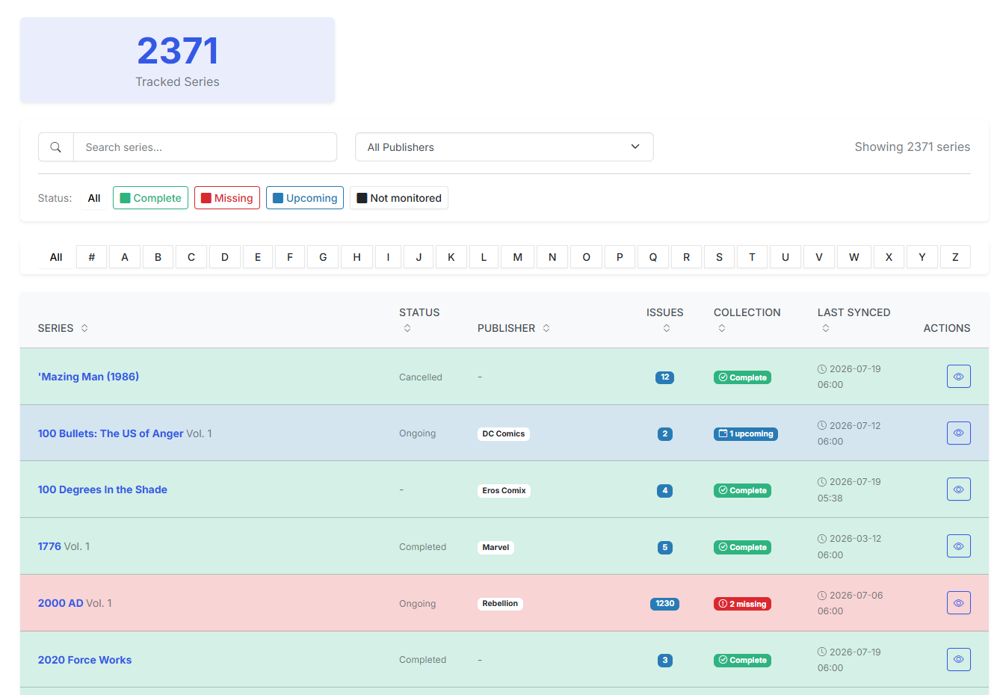
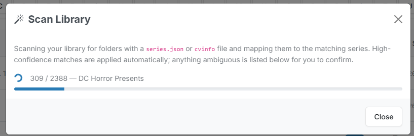
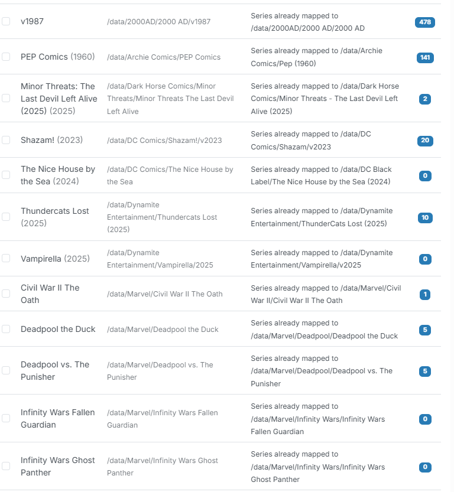
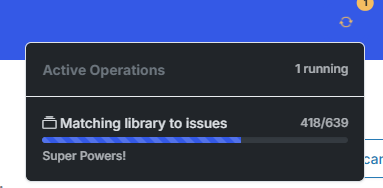

# Automap (Scan Library)

If you have an existing comic collection, adding titles to the Pull List one by one is time-consuming. **Scan Library** automatically inspects the sidecar files already present across your storage directories, resolves each to a verified Metron or ComicVine series, and populates your Pull List in a single batch pass.

## How Automap Works

1. Scans your configured library directories for **`series.json`** and **`cvinfo`** sidecar files (such as those generated by Mylar3 or earlier CLU passes).
2. Queries **Metron** (and ComicVine) to resolve each sidecar to an official series ID.
3. Groups every scanned directory into one of three classifications:

{: .center-image }

## Classification Categories

| Classification | Meaning | Action Required |
| --- | --- | --- |
| **Auto** | CLU resolved the sidecar to a single, confident series match. | None. Mapped automatically upon commit. |
| **Needs review** | A probable match was found, but requires user confirmation (e.g. multiple candidate volumes or fuzzy naming). | Confirm or select the correct volume in the review modal. |
| **Skipped** | No usable sidecar or matching provider record was found. | Review the displayed reason; map manually later if desired. |

## The Review Workflow

Directories marked **Needs review** are presented in an interactive review modal. For each item, select the correct series volume (or accept CLU's suggestion) before applying:

{: .center-image }

!!! tip "Guided Setup Integration"
    The **Pull List Scan** step during [Guided Setup](../../getting-started/guided-setup.md#pull-list-scan) runs this exact scan. Review candidate matches promptly, as temporary scan sessions expire after 15 minutes.

When you commit the mappings, CLU executes the following background tasks:

- **Backfills sidecars**: Writes updated `series.json` and `cvinfo` files so each folder retains permanent series identification.
- **Synchronizes checklists**: Queries the provider in the background to retrieve full issue lists, publication dates, and creator credits.
- **Reconciles collection**: Scans local files to record which issues you already own versus which are wanted.

{: .center-image }

## Import Safeguards & Behavior

- **ComicVine fallback**: Series that exist exclusively on ComicVine are fully supported and mapped cleanly.
- **Preserves existing metadata**: Existing sidecar `publisher` and `status` values are preserved rather than overwritten.
- **Mylar folder structures**: Standard Mylar volume folder layouts (such as `<publisher>/<series>/v<year>/`) are parsed accurately without mistaking the `v<year>` folder for the series title.
- **Intelligent monitoring defaults**: Fully collected series with an ended publication status (Cancelled or Completed) default to **Not Monitored**, preventing unnecessary search queries for finished runs.

{: .center-image }

## Scanning a Single Folder

To apply this same identification process to a single directory rather than running a full library sweep, select **Add to Pull List** from any series folder's action menu in the File Manager or Collection view.

Single-folder mapping runs the identical resolution pipeline: sidecars are created, checklists are synced, and owned counts are tallied. If a sidecar is missing or unreadable, a Metron search picker opens directly so you can select the correct title.

See [Additional Features](../file-management/additional.md#add-to-pull-list) for detailed outcome codes.

## Related Documentation

- [Pull List](pull-list.md) — Managing your subscribed series and collection health.
- [Import from Mylar3](../mylar-import.md) — Migrating a Mylar3 watchlist from database and config files.
- [Series Page](series.md) — Managing individual series checklists and mapping paths.
