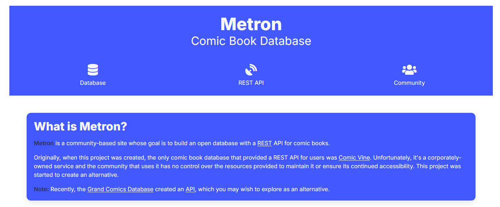

# Pull List and Series Management

{: .center-image }

CLU features an integrated Pull List and series tracking system powered by the [Metron](https://metron.cloud/) database. Similar to a pull list at a local comic book shop, it lets you subscribe to ongoing series, track weekly release schedules, identify missing back-catalogue issues, and coordinate automated downloads.

## Core Capabilities

- **Weekly Releases**: Browse current, past, and upcoming releases, filter by publisher, and subscribe in one click.
- **Series Management**: Map series to local folders, manage custom naming patterns, and reconcile owned versus missing issues.
- **Automated Downloads**: Feed missing issues directly into GetComics, Usenet, and DC++ download sweeps.
- **Library Automap**: Scan existing sidecars (`series.json` and `cvinfo`) to import your entire library to the Pull List in a single pass.

## Pull List Sections

| Section | Description | Documentation |
| --- | --- | --- |
| **Releases** | Browse weekly release schedules with live publisher filter pills and deep-linkable URLs. | [Releases](releases.md) |
| **Series** | Manage series subscriptions, folder mapping, and issue-level statuses. | [Series](series.md) |
| **Pull List** | Central dashboard showing collection health color-coding and bulk monitoring toggles. | [Pull List](pull-list.md) |
| **Wanted** | Track missing back-catalogue issues and upcoming releases with integrated download searching. | [Wanted](wanted.md) |
| **Weekly Packs** | Automate weekly bulk publisher pack downloads (Marvel, DC, Image, Dark Horse, Indie). | [Weekly Packs](weekly.md) |
| **Series Search** | Search the Metron catalog by keyword to subscribe to new or ongoing series. | [Series Search](series-search.md) |
| **Publishers** | Manage publisher directory paths and view provider-linked publisher records. | [Publishers](publishers.md) |
| **Automap** | Scan existing library folders and sidecars to rapidly populate your Pull List. | [Automap (Scan Library)](automap.md) |

## Metron API Configuration

{: .center-image }

The Pull List relies on the Metron comic database for release calendars, issue checklists, and creator metadata.

To enable Pull List features, register for a free account at [Metron](https://metron.cloud/) and enter your credentials in **[Settings > Metadata Providers](../app-settings/metadata.md)**.