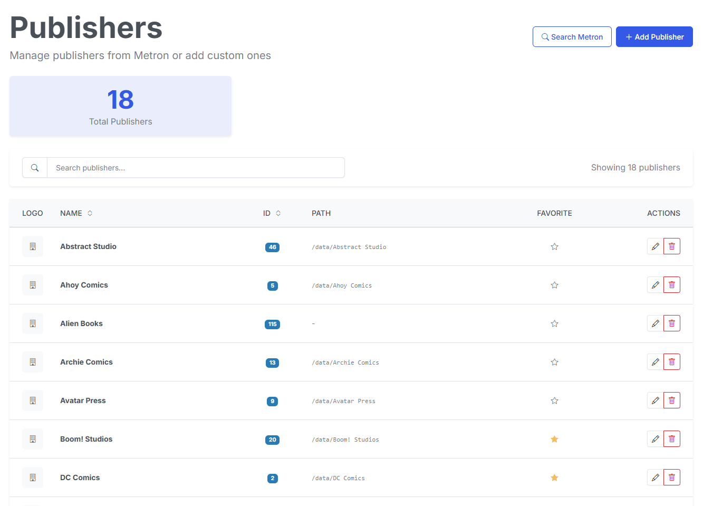
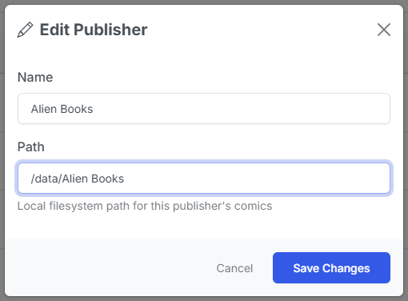

# Publishers

{: .center-image }

The **Publishers** table manages publisher records registered within your Pull List system. When you subscribe to a series, CLU automatically links the publisher to its official Metron publisher record and assigns its storage directory.

## Publisher Table Fields

| Field | Description |
| --- | --- |
| **ID** | The unique publisher identifier from the Metron database. |
| **Name** | The canonical publisher name (e.g. Marvel, DC Comics, Image). |
| **Path** | The local storage directory assigned to this publisher. |
| **Favorite** | Indicates whether the publisher is pinned as a favorite on the collection dashboard. |
| **Created At** | Timestamp recording when the publisher was registered in CLU. |
| **Actions** | Edit the publisher's assigned directory path or delete the publisher record. |

## Editing Publisher Paths

Click the edit button on any publisher row to open the edit dialog:

{: .center-image }

You can modify the display name or update the mapped storage directory. Updating the path ensures future series subscribed under that publisher are filed into the correct directory location.
