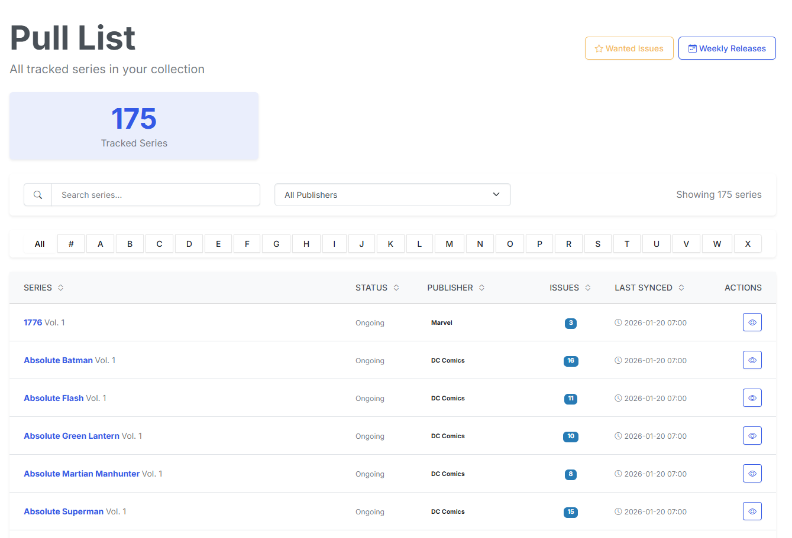

# Pull List

{: .center-image }

The **Pull List** serves as your central subscription manager, providing an overview of every tracked series, its collection health, issue counts, and monitoring status.

## Filtering and Sorting

The Pull List table includes fast search and sorting controls to help manage large libraries:

### Filter Options

| Filter | Description |
| --- | --- |
| **Search Box** | Live filters series titles by keyword as you type. |
| **Publisher** | Dropdown menu to isolate series from a specific publisher. |
| **A–Z Bar** | Quick letter jump bar to filter titles alphabetically. |
| **Status Filter** | Filters by collection state (Complete, Missing, or Upcoming). |

### Sorting Columns

Click any column header to toggle ascending or descending sort order:

- **Series**: Alphabetical sort by title.
- **Publisher**: Group series by publisher name.
- **Status**: Sort by collection completeness.
- **Issues**: Sort by total issue count.
- **Last Synced**: Order by the date CLU last verified records against Metron.

Clicking any series title opens its dedicated [Series page](series.md) to manage issues and paths.

## Monitoring Status

{: .center-image }

Each series has a **Monitor** toggle:

- **Monitored**: Missing issues appear on the [Wanted](wanted.md) page and are actively queried during nightly automated downloader sweeps.
- **Not Monitored**: The series row is greyed out, and automated downloader queries are disabled.

Turn off monitoring for completed runs where you already have every issue or when missing issues are unavailable.

## Collection Health Color-Coding

Rows are color-coded based on their collection status:

| Status | Meaning |
| --- | --- |
| **Complete** | You own every currently released issue of the series. |
| **Missing** | One or more released issues are missing from your collection. |
| **Upcoming** | You own all released issues, and future issues are scheduled with upcoming store dates. |

Colors adapt to your selected user theme. Use the on-page legend as a quick reference.

## Bulk Actions

You can apply status updates across multiple series at once using the multi-select checkboxes:

- **Select single series**: Click the checkbox next to the title.
- **Select range**: Click the first checkbox, then hold **SHIFT** and click a second checkbox.
- **Toggle individual series**: Hold **CTRL** (or **CMD** on macOS) while clicking checkboxes.

Once rows are selected, use the bulk action toolbar to switch all selected series to **Monitored** or **Not Monitored** in a single click.

## Import Defaults

When importing series in bulk via [Scan Library](automap.md), monitoring flags are initialized conservatively:

- Series that are both **fully owned** and have an **ended publication status** (Cancelled or Completed) default to **Not Monitored** to prevent unnecessary search requests for finished runs.
- Series with uncollected issues or active publication runs default to **Monitored**.