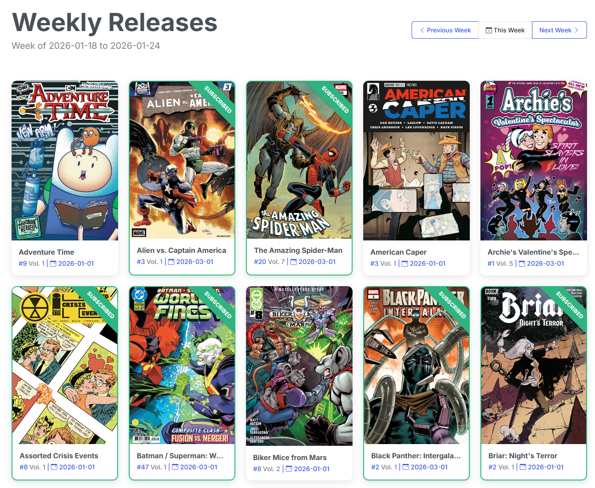
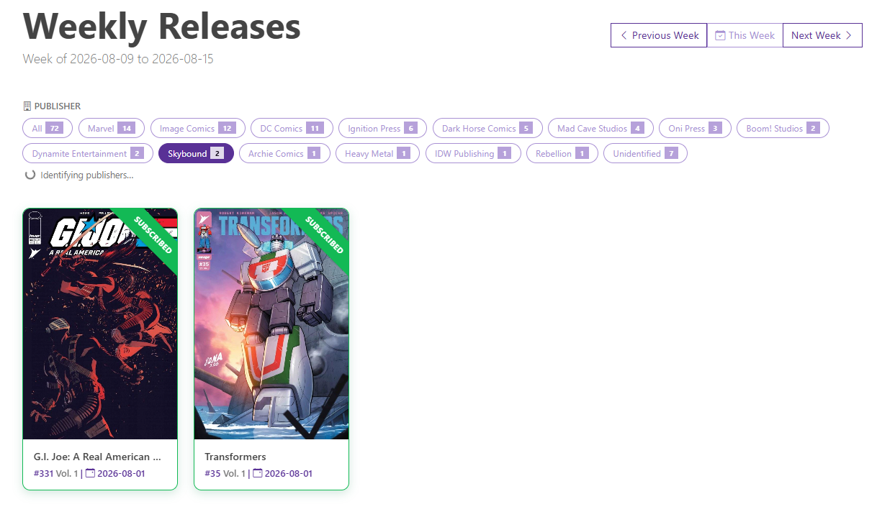

# Releases

{: .center-image }

The **Releases** page displays comic books scheduled for publication during a given week, based on data from the Metron comic database.

Clicking any comic in the release grid opens the series detail view, where you can:

- **Subscribe to the series** to add it to your Pull List.
- **Map to an existing directory** or update its storage path.
- **Check for new issues** or scan local folders for recently added files.
- **Manage monitoring status** for automated downloader sweeps.

## Navigating Release Weeks

Use the navigation arrows at the top of the page to move between past, current, and upcoming release weeks.

## Publisher Filter

Interactive publisher filter pills above the grid display real-time issue counts for each publisher releasing books that week:

{: .center-image }
/// caption
Publisher filter pills with live counts. Selections mirror into the URL.
///

Click any publisher pill to isolate releases from that publisher. Because filtering runs client-side in the browser, switching between publishers is instantaneous and requires no page reloads or additional API calls.

### Deep-Linkable Filter URLs

Your selected publisher filter is automatically mirrored into the browser URL as a query parameter (e.g. `?publisher=Marvel`). This allows you to bookmark specific publisher views or use your browser's back and forward buttons to cycle through previous filter states.

### The list fills in as you watch

When viewing a release week for the first time (a "cold" week), the publisher pills populate progressively over your initial visits rather than appearing all at once.

Metron's weekly issue endpoint returns issue objects that associate with a series but omit the parent publisher name. Querying publishers individually for every release would require roughly 150 API calls per week, quickly consuming your daily Metron API quota.

To prevent rate-limit exhaustion, CLU utilizes a **self-warming cache**:

1. A background worker queries Metron using server-side publisher filters to resolve major publishers in bulk with single requests.
2. Capped individual lookups are performed for remaining independent and small-press titles.
3. Newly discovered publishers are added to subsequent bulk passes, converging on a complete publisher list within a few passes.

Once a week's publisher records are cached locally, filter pills render instantly on every subsequent visit.
