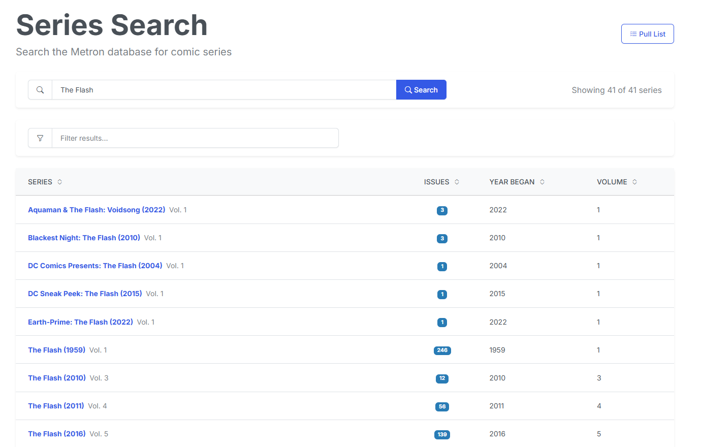

# Series Search

{: .center-image }

The **Series Search** tool allows you to query the [Metron](https://metron.cloud) comic database by title to find series checklists, review issue runs, and subscribe to titles.

## Searching for a Series

1. Type the series title in the search input.
2. Click the <i class="bi bi-search text-info"></i> **Search** button or press **ENTER**.
3. CLU queries Metron and returns matching series records, displaying publication years, publisher names, and total issue counts.

## Filtering Results

If a query returns multiple series with similar names or multiple volumes across years, use the **Filter Results** field to quickly narrow down the results list.

## Subscribing or Mapping

Clicking on any series in the results list opens its full [Series page](series.md), where you can subscribe to the title, map it to an existing storage directory, or view its issue checklist.