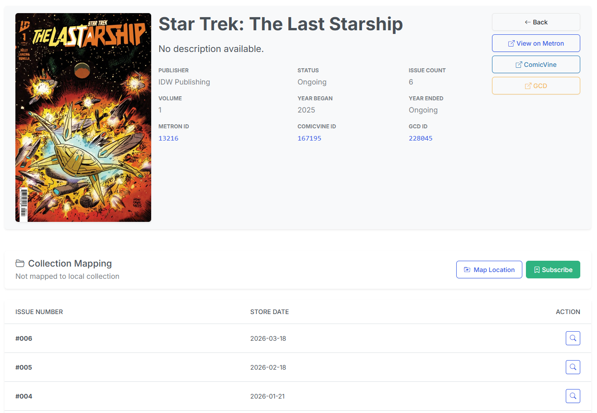
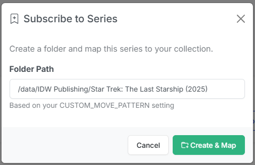
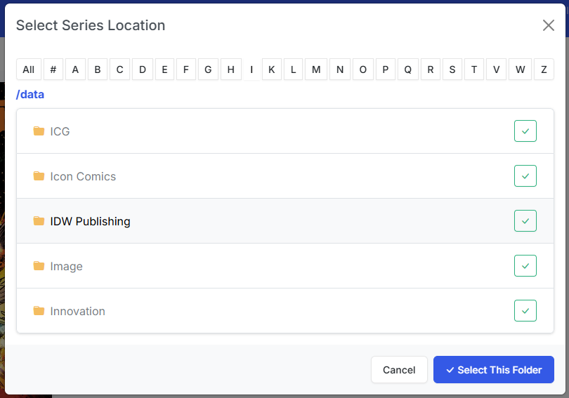
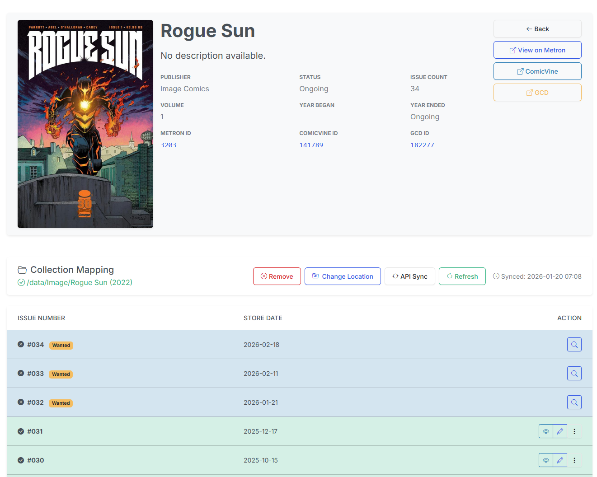
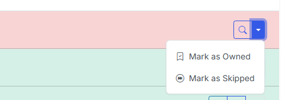
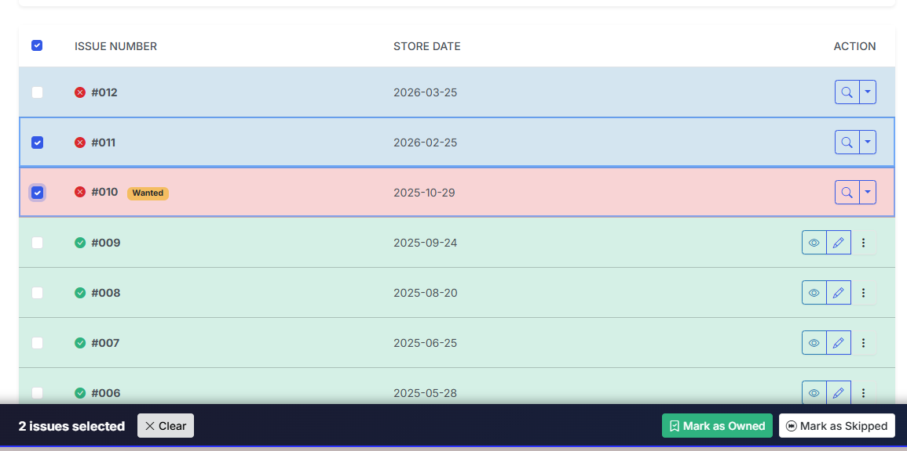

# Series

The **Series** page displays the complete checklist and metadata for a selected series from the Metron database. From this view, you can manage your subscription, map directory paths, and control tracking status.

## Subscribing to a Series

{: .center-image }

When viewing a series you are not currently tracking, two primary actions are available:

### Subscribe

Clicking **Subscribe** prompts you for the storage path where issues of this series will be saved.

{: .center-image }

The proposed path defaults to your configured **Custom Move Pattern** in [File Settings](../app-settings/file-settings.md). You can customize this path as needed:

!!! tip "Common Folder Patterns"
    Standard series typically use:
    `/{Publisher}/{Series} ({Year})/`
    
    Multi-volume series can be organized using volume subfolders:
    `/{Publisher}/{Series}/v{Year}/`

Click **Create & Map** to create the directory (if it does not already exist), register the subscription, and create a persistent `.cvinfo` / `series.json` sidecar.

### Map Location

If you already have a folder containing issues of this series, click **Map Location** to link the subscription to that existing directory.

{: .center-image }

Navigate to the folder and click **Select This Folder** (or the checkmark icon). CLU scans the directory, matches your existing files against the checklist, and updates your owned count.

## Managing Active Subscriptions

{: .center-image }

For subscribed series, the header toolbar provides the following actions:

### Remove

Click <i class="bi bi-x-circle text-danger"></i> **Remove** to unsubscribe from the series and remove it from your Pull List. Your local comic files are left untouched.

### Change Location

Click <i class="bi bi-folder-symlink text-info"></i> **Change Location** to re-map the series to a different folder. CLU updates the stored mapping and reconciles your files.

### API Sync

Click <i class="bi bi-arrow-repeat text-dark"></i> **API Sync** to query the Metron API for new issue solicitations, publication date updates, and revised series descriptions. This sync runs automatically every night across all subscribed series.

### Refresh

Click <i class="bi bi-arrow-clockwise text-success"></i> **Refresh** to purge local caches, refetch the latest series and issue records from Metron (including newly added creator credits), and rescan your local storage folder to reconcile file matches.

### Monitor

The **Monitor** toggle controls whether CLU actively tracks and searches for missing issues:

- When **Monitored**: Missing issues appear on the [Wanted](wanted.md) page and are included in nightly automated download sweeps (GetComics, Usenet, DC++).
- When **Not Monitored**: The series is greyed out on the [Pull List](pull-list.md), and automated downloader searches are paused.

Turn off monitoring for completed runs where you already own all desired issues, or when remaining issues are out-of-print and unavailable.

### On the Stack

Enable **On the Stack** to allow this series to surface its next unread issue in the **On the Stack** carousel on your [Collection homepage](../collection/index.md#on-the-stack).

## Issue Statuses: Wanted, Owned, and Skipped

Each issue in the series checklist carries a tracking status:

{: .center-image }

- **Owned**: Issues physically detected in your mapped folder, or issues you manually marked as owned (e.g. issues collected in an omnibus or trade paperback).
- **Wanted**: Released issues that are absent from your local folder. These are automatically included in automated download sweeps.
- **Skipped**: Issues you do not wish to collect. Skipped issues are excluded from download searches.

### Multi-Select Actions

{: .center-image }

Select multiple issues using the checkboxes to perform bulk status updates:

- **Mark as Owned**: Manually mark the selected issues as collected.
- **Mark as Skipped**: Exclude selected issues from search sweeps.
- **Mark as Wanted**: Re-enable tracking for issues previously marked as Owned or Skipped.