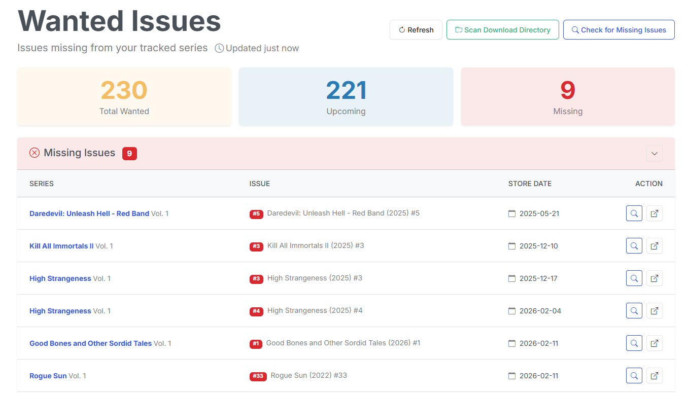
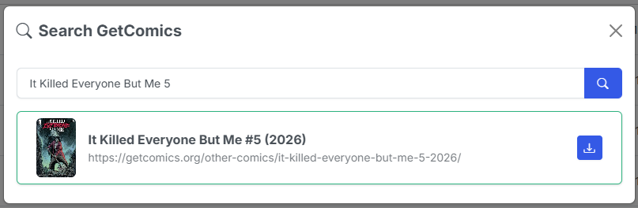
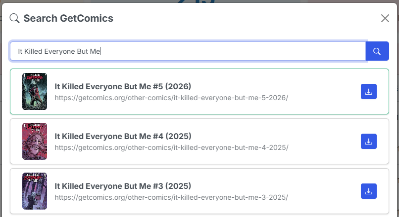
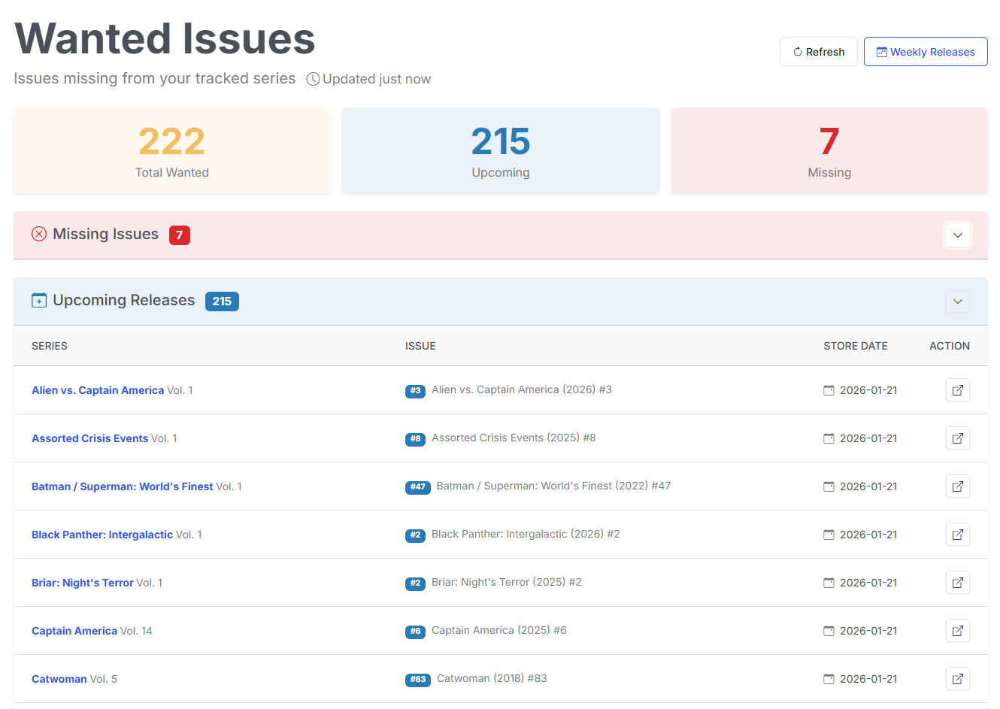

# Wanted

{: .center-image }

The **Wanted** page tracks all absent and upcoming issues across your subscribed series and bookmarked reading lists.

The top toolbar provides three global actions:

### Refresh

Re-scans all series on your Pull List to recalculate wanted and missing counts based on your active library files.

### Scan Download Directory

Scans your download directory to detect and process any newly completed files deposited since the last pass.

### Check for Missing Issues

Manually initiates an automated search sweep for wanted issues across all enabled download sources (GetComics, [Usenet](../usenet/index.md), and [DC++](../dcpp/index.md)), ranked according to your configured [Source Priority](../usenet/source-priority.md).

Active sweeps report progress directly into the **Active Operations** indicator in the top navigation bar. If a scheduled sweep is already in progress, additional triggers stand down to avoid redundant concurrent requests.

## Missing Issues

The **Missing Issues** section lists all uncollected issues whose official **Store Date** has already passed, ordered chronologically from oldest to newest.

### Search for Missing Issues

You can search for any missing issue across your download providers directly within CLU:

1. Click the <i class="bi bi-search text-info"></i> **Search** button next to any missing issue.

{: .center-image }

2. A unified search modal opens, querying GetComics, Usenet indexers, and DC++ concurrently. Results are grouped by source under prioritized section headers.
3. If necessary, adjust search keywords to refine queries for difficult-to-find titles:

{: .center-image }

4. Click the <i class="bi bi-download text-info"></i> **Download** button on any result to dispatch the file to your download client.

## From Reading Lists

The **From Reading Lists** section displays missing issues sourced from [tracked reading lists](../collection/reading-lists.md).

This section appears whenever **[Track Wanted](../collection/reading-lists.md#track-wanted)** is toggled on for at least one reading list. Unmatched entries in tracked lists are treated as wanted issues and queried during automated nightly download sweeps.

| Column | Description |
| --- | --- |
| **Series** | The series title recorded in the reading list. |
| **Issue** | The issue number required by the list. |
| **Year** | The publication year (if recorded by the source list). |
| **Reading List** | The source reading list containing the missing entry. |
| **Actions** | Single-click search across your configured download sources. |

### Search Logic for Reading List Entries

- **Back-catalogue entries without dates**: Unlike future series solicitations (which wait for an announced store date before searching), reading list entries lacking a publication year are presumed to be released back-catalogue issues and are actively searched.
- **7-Day Cooldown**: If an issue download fails or cannot be unpacked, CLU applies a 7-day cooldown to prevent re-downloading the same broken archive every night.
- **Invalid entries excluded**: Entries with missing series names or blank issue numbers are automatically excluded from search sweeps.
- **Instant sync**: Mapping a missing file by hand removes it from this section immediately, and clearing a mapping restores it.

## Upcoming Issues

{: .center-image }

The **Upcoming Issues** section lists future releases for your subscribed series, ordered by their announced **Store Date**. Once an issue's store date arrives, it automatically transitions into the **Missing Issues** list if it has not yet been acquired.