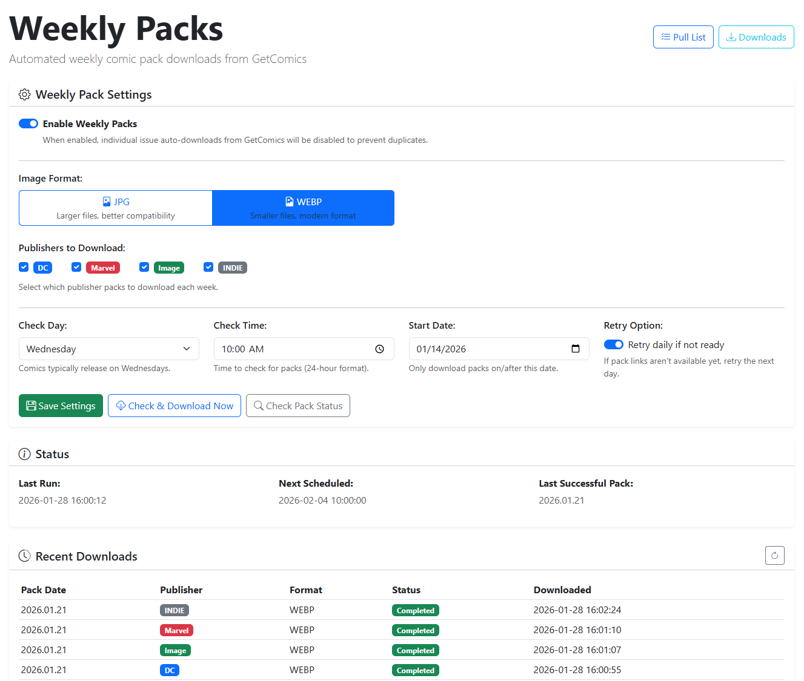
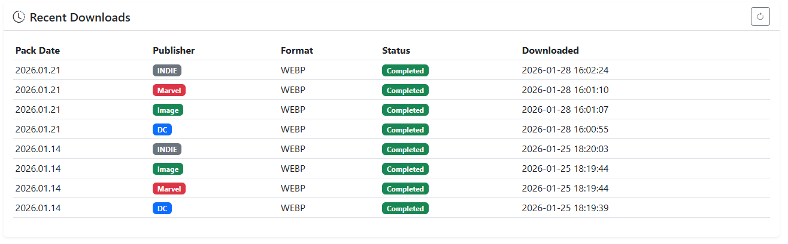

# Weekly Packs

{: .center-image }

If you prefer downloading entire publisher release bundles rather than managing individual issues, the **Weekly Packs** feature automatically checks for and downloads weekly release packs.

!!! note "Weekly Packs Disables Individual Auto-Downloads"
    Enabling Weekly Packs disables individual-issue automated downloads in CLU. Weekly packs provide comprehensive coverage for chosen publishers, replacing daily per-issue sweeps.

## Supported Publishers

Weekly packs are available for the following publisher categories:

- **Marvel**
- **DC Comics**
- **Image Comics**
- **Dark Horse Comics**
- **Indie** (covers all independent and small-press publishers)

Select one or more publishers to include their release bundles in your download schedule.

## Download Options

Configure the scheduling and retrieval settings for weekly pack downloads:

| Option | Description |
| --- | --- |
| **Check Day** | Day of the week to begin checking for newly released weekly packs. |
| **Check Time** | Time of day to initiate the availability check. |
| **Start Date** | The starting date for pack downloads (supports up to 6 months of historical packs). |
| **Retry Option** | Automatically retries daily if the weekly pack has not yet been uploaded. |
| **Save Settings** | Saves configuration changes and updates the background schedule. |
| **Check & Download** | Immediately initiates a check and downloads the latest pack if available. |
| **Check Pack Status** | Queries download sources to check whether the latest pack is released without downloading. |

## Execution Status

The status panel reports the **Last Run** timestamp, **Next Scheduled Run**, and the date of the **Last Successful Pack** retrieved.

## Recent Downloads

{: .center-image }

The recent downloads table tracks historical pack acquisitions:

| Column | Description |
| --- | --- |
| **Pack Date** | Official release date of the weekly pack. |
| **Publisher** | Publisher category of the pack. |
| **Format** | Image format of the comics contained in the pack (`JPG` or `WEBP`). |
| **Status** | Ingestion status (`Success`, `Processing`, or `Failed`). |
| **Downloaded** | Timestamp recording when the pack was successfully retrieved. |