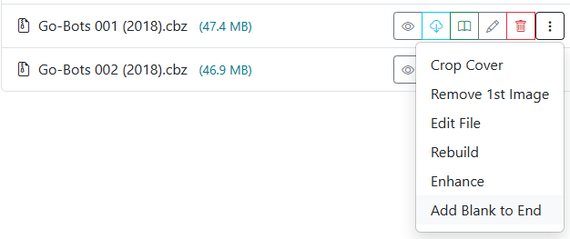

# Add Blank Image

{: .center-image }

Accessible in the [File Manager](../file-management/index.md) via the <i class="bi fs-2 bi-three-dots-vertical text-dark"></i> menu on any comic card.

In two-page spread and dual-page reader modes (such as Komga, Kavita, or desktop comic viewers), pages are rendered side-by-side in pairs. If a comic or manga volume has an odd number of pages, or lacks an alignment spacer, every subsequent two-page spread throughout the book can become misaligned.

The **Add Blank Image** tool inserts a blank image (`zzzz9999.png`) at the very end of the CBZ archive. This evens out the page count, ensuring dual-page layouts and splash spreads display across matching panels without modifying story content.
