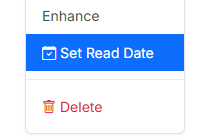
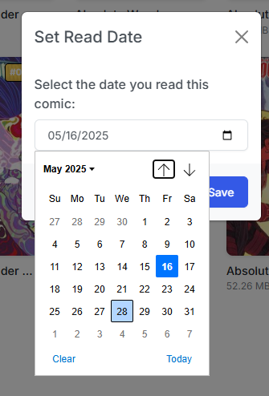

# Add Read Date

{: .center-image }

Accessible only in the [Collection view](../collection/index.md) via the <i class="bi fs-2 bi-three-dots-vertical text-dark"></i> menu on any comic card.

While CLU automatically records reading dates when comics are read through the built-in reader, **Add Read Date** lets you manually record or adjust the completion date for issues read outside the browser.

{: .center-image }

Logged reading dates feed directly into the reading activity charts, timelines, and annual reading heatmaps on the [Library Insights](../insights/insights.md) page.
