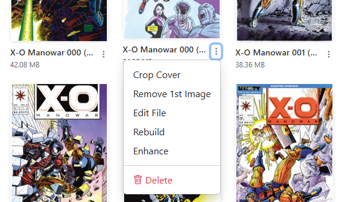
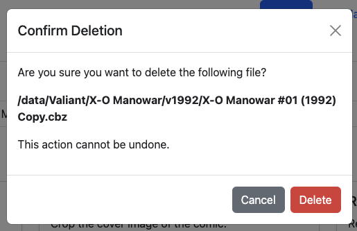

# Delete File

{: .center-image }

Accessible in the [File Manager](../file-management/index.md) via the <i class="bi fs-2 bi-trash text-danger"></i> icon, or in the [Collection view](../collection/index.md) via the <i class="bi fs-2 bi-three-dots-vertical text-dark"></i> menu on any comic card.

The **Delete File** utility removes an individual comic issue from disk. A confirmation dialog displays the target file name to prevent accidental removals:

{: .center-image }

## Soft-Delete & Trash Can Protection

If the [Trash Can](../app-settings/file-settings.md#trash-can) is enabled in settings, deleted files are moved to `/cache/trash` rather than being permanently destroyed, allowing you to restore them if deleted by mistake.

See [File Management: Delete & Trash](../file-management/delete.md#soft-delete--the-trash-can) for full details on recovery and size-based trash eviction.
