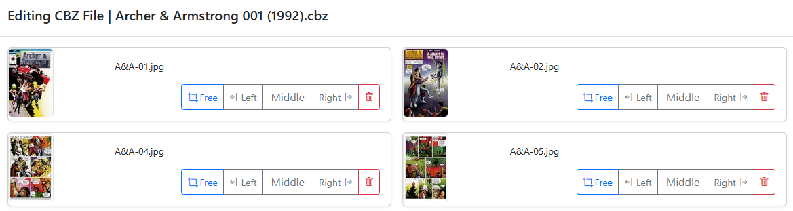
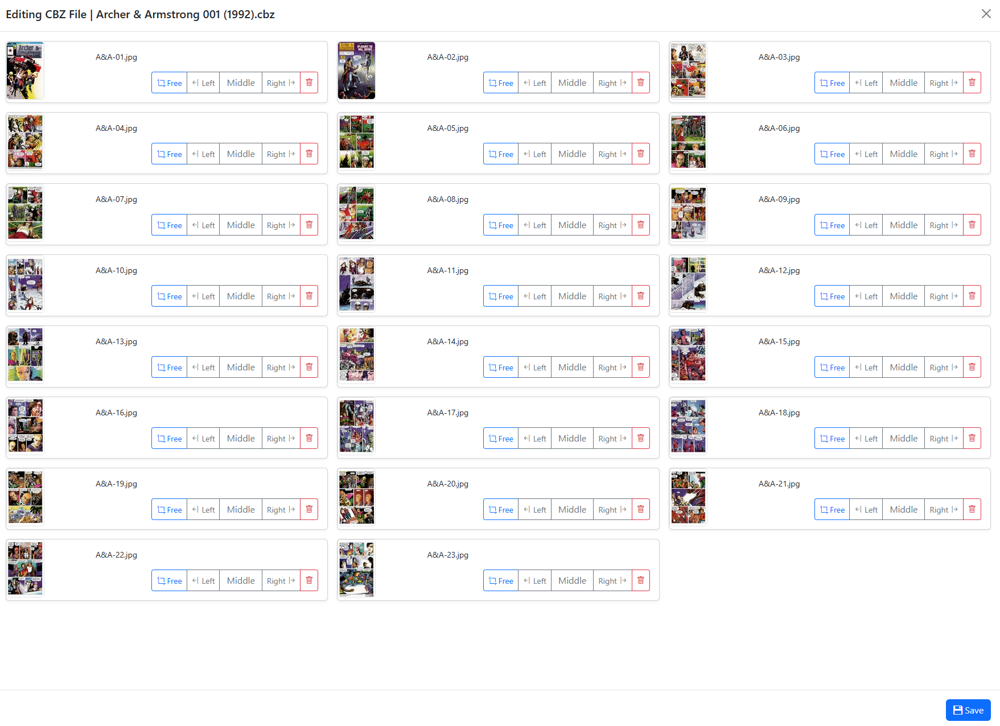
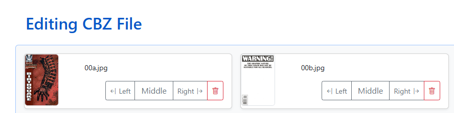
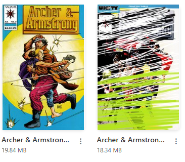
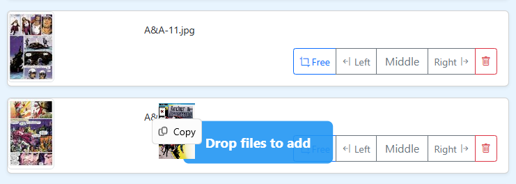
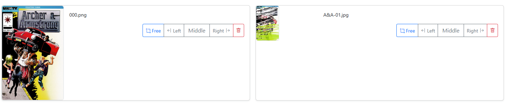
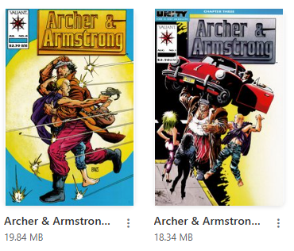
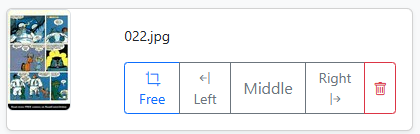
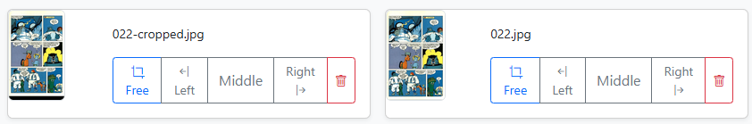
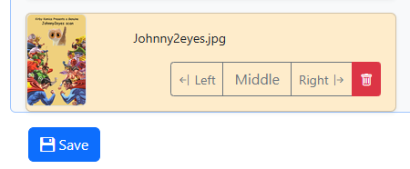

# Edit CBZ File

When viewing an issue in the [File Manager](../file-management/index.md) or [Collection](../collection/index.md), click the <i class="bi bi-three-dots-vertical fs-2 text-icon"></i> menu and select **Edit File** (or **Edit CBZ**) to open the in-browser archive editor.

CLU unpacks the archive into an isolated temporary workspace and loads the pages into an interactive visual grid:

From this interface, you can perform several operations:

## Rename and Reorder Pages

Click on any filename to edit it inline. Press `ENTER` to save the new name. Pages automatically re-sort in the grid according to alphanumeric ordering.

For example, updating a filename to `00b.jpg` causes it to sort immediately after `00a.jpg`:

## Upload New or Replacement Pages

You can drag and drop image files directly into the editor to add missing pages or replace corrupted covers:

1. Locate your replacement cover image and drag it into the editor modal.

2. The image is uploaded, scaled to match the dimensions of the other pages in the archive, and inserted into alphanumeric order.

!!! note "Allowed Image Formats"
    Only image files are permitted inside the archive (`.jpg`, `.jpeg`, `.png`, `.gif`, `.webp`, `.bmp`). Non-image files will be rejected upon upload.

3. Once the replacement image is inserted, delete the old or damaged cover image and save changes.

## Crop Images

The built-in crop tool provides precise controls for isolating panel artwork or cover sections from multi-page spreads:

- **`<-| Left`**: Crops and saves the left half of the image as the new cover. The original full spread is retained and repositioned as the second image in the archive.
- **`Right |->`**: Crops the image to the right half and assigns it as the primary cover.
- **`Middle`**: Extracts the center panel for tri-fold covers.
- **`Free Crop`**: Allows click-and-drag freeform cropping directly on the canvas:
    - Click and drag to define the crop area.
    - Hold **SPACE** to reposition the selection box.
    - Hold **SHIFT** to lock standard comic page aspect ratios.

{: .center-image }

!!! info "Preserves Original Images"
    Crop operations preserve the original un-cropped spread inside the archive, ensuring you can undo an accidental crop by removing the cropped page and restoring the original.

## Delete Pages

Click the <i class="bi bi-trash text-danger"></i> icon on any page card to delete it from the archive. This is useful for stripping non-story pages, advertisements, or scanner promotional cards.

{: .center-image }

!!! danger "Immediate Deletion"
    Page deletions within the editor take effect immediately upon confirmation.

## Save Changes

Click **Save** to repack the archive and clean up temporary files.

### Automated Junk File Cleanup

In [File Settings](../app-settings/file-settings.md), you can configure specific file extensions to be automatically purged whenever a CBZ is edited (e.g. `.nfo`, `.sfv`, `.db`, `.DS_Store`). Non-image metadata files such as `ComicInfo.xml` are automatically preserved during repacking.