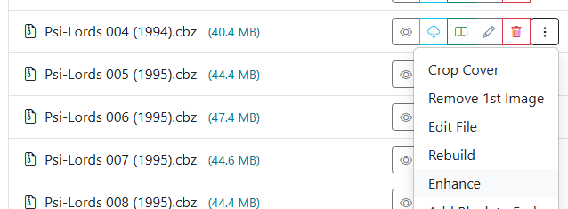

# Enhance Images

{: .center-image }

Accessible from the <i class="bi fs-2 bi-three-dots-vertical text-dark"></i> menu on any comic card in the [File Manager](../file-management/index.md) or [Collection view](../collection/index.md).

Vintage print scans and older digital comic releases often suffer from faded ink, elevated gray black-levels, and washed-out colors. The **Enhance Images** tool applies a non-destructive image curve optimization across every page in the selected CBZ archive, enriching contrast and color vibrancy while preserving bright paper highlights and fine line art.

## Visual Comparison

| Before | After |
| :---: | :---: |
|  |  |

For a full technical breakdown of the modified S-curve algorithm and color space handling, see [Directory Features: Enhance Images](../directory-features/enhance.md#enhancement-algorithm).