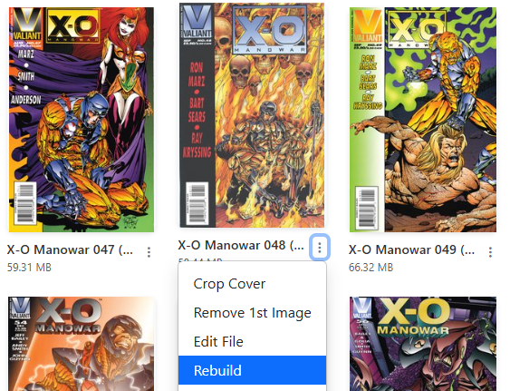

# Single File Rebuild

{: .center-image }

Accessible from the <i class="bi fs-2 bi-three-dots-vertical text-dark"></i> menu on any comic card in the [File Manager](../file-management/index.md) or [Collection view](../collection/index.md).

Single File Rebuild performs two primary functions:

1. **Repairs existing CBZ files**: Unpacks and repackages the archive to resolve zip header errors, strip internal folder clutter, and repair archives that fail to open in comic readers.
2. **Converts CBR / RAR to CBZ**: Re-packs single RAR-compressed files into standardized CBZ archives.

## Automated Error Recovery

During a rebuild, CLU unpacks the archive into an isolated staging directory and validates the contents before replacing the original file.

If extraction fails (for example, if the archive is encrypted or truncated), CLU automatically aborts the operation, leaves your original comic file untouched, and logs the detailed error on the **[Problem Files](../problem-files/index.md)** page under the **Rebuild** category.

!!! warning "Container Repairs vs. Corrupt Image Data"
    Rebuilding repairs the **archive container**, not corrupted image data. It successfully recovers archives misnamed with the wrong extension (such as a RAR file labeled as `.cbz`) or broken zip directory headers. However, if the underlying image files inside the archive suffer from CRC corruption, rebuilding cannot restore damaged pixels.

    For severely corrupted files, use **[Find a replacement](../problem-files/replacing-a-file.md)** directly from its row on the Problem Files page.
