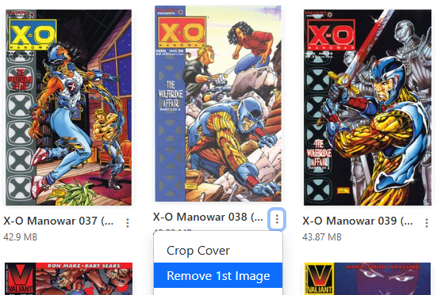

# Remove First Image

{: .center-image }

Accessible from the <i class="bi fs-2 bi-three-dots-vertical text-dark"></i> menu on any comic card in the [File Manager](../file-management/index.md) or [Collection view](../collection/index.md).

Older comic releases and scans occasionally prepend a non-cover image to the beginning of the archive — such as a scanner credit card, watermarked logo, or advertising splash page. This causes library browsers to display the credit card rather than the real comic cover.

The **Remove First Image** tool unpacks the archive, permanently removes the first image file, and repacks the CBZ so page two becomes the new primary cover.

| Before (Scanner Card First) | After (True Cover Restored) |
| :---: | :---: |
|  |  |

!!! danger "Permanent Deletion"
    Removing the first image is an immediate, irreversible operation. If you are unsure whether the first file is truly an extraneous scanner card or the actual cover, open the comic in the built-in reader or use [Edit CBZ File](edit.md) to inspect and manage pages visually before deleting.