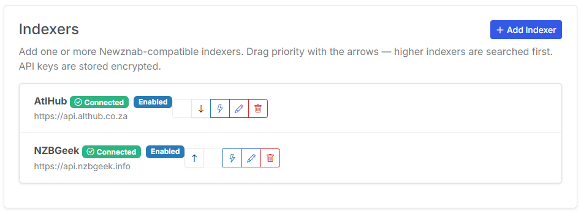

# Adding Newznab Indexers

Indexers function as the search engines of Usenet. When searching for a missing comic, CLU queries your configured **Newznab** indexers for releases matching the wanted series and issue, then passes the matching `.nzb` release directly to your [download client](setup.md).

Indexers are configured in the **Download Clients** tab in [Settings](../app-settings/index.md).

{: .center-image }

## Indexer Fields

| Field | Description |
| --- | --- |
| **Name** | A recognizable label for the indexer (e.g. *Drunkenslug*, *Geek*, *NinjaCentral*). |
| **URL** | The full base API URL for your indexer (e.g. `https://api.indexer.com`). |
| **API Key** | Your personal API key provided in your indexer account profile. |
| **Category** | The Newznab category ID to query. Defaults to standard comic category **`7030`**. |
| **Priority** | Sets query precedence when multiple indexers are enabled (see below). |

!!! info "Comics Category ID"
    Newznab-compliant indexers universally standardize comic books under category ID **`7030`** (*Books > Comics*). Only alter this value if your specific indexer utilizes a custom non-standard categorization schema.

## Indexer Priority Ordering

When configuring multiple indexers, **Priority** determines the sequence in which indexers are queried and displayed:

- Higher-priority indexers are searched first.
- Results from higher-priority indexers are displayed first in manual search modals and automated queues.

Indexer priority is internal to your Usenet configuration. It works in conjunction with global [Source Priority](source-priority.md), which decides whether Usenet as a whole is queried before or after GetComics and DC++.

!!! note "Search Visibility"
    Usenet results remain hidden in manual search modals and automated sweeps until at least one indexer has been configured and enabled with a valid API key.
