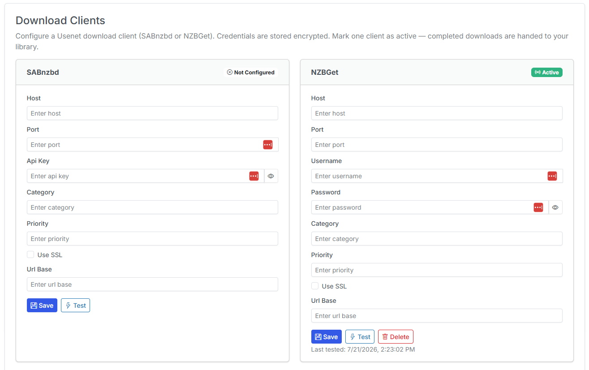

# Adding a Download Client

Your download client (**SABnzbd** or **NZBGet**) is the dedicated application that receives NZB files from CLU, connects to your Usenet provider, downloads and verifies binary articles, and assembles the completed comic archives.

{: .center-image }

Download clients are added and managed from the **Download Clients** tab in [Settings](../app-settings/index.md).

!!! info "Client Group Scope"
    CLU supports one active client per client group:
    - You can configure credentials for both SABnzbd and NZBGet, but only the client currently toggled as active will receive grabs.
    - Usenet clients belong to a separate group from [DC++ clients](../dcpp/setup.md), allowing you to run an active Usenet client and an active AirDC++ client simultaneously.

## SABnzbd Configuration

| Field | Description |
| --- | --- |
| **Host** | The hostname or IP address where SABnzbd is reachable (e.g. `192.168.1.50` or container hostname `sabnzbd`). |
| **Port** | The SABnzbd web interface port (default `8080`). |
| **API Key** | Found in SABnzbd under *Config > General > API Key*. |
| **Category** | The SABnzbd category assigned to comic grabs (e.g. `comics`). Highly recommended so finished files land in your designated WATCH folder. |

## NZBGet Configuration

| Field | Description |
| --- | --- |
| **Host** | The hostname or IP address where NZBGet is reachable. |
| **Port** | The NZBGet web interface port (default `6789`). |
| **Username** | The NZBGet control username (default `nzbget`). |
| **Password** | The NZBGet control password. |
| **Category** | The NZBGet category assigned to comic grabs (e.g. `comics`). |

## Testing the Connection

After entering your client details, click **Test Connection** to verify network connectivity and authentication. CLU evaluates the connection and provides human-readable feedback:

| Result | Status | Troubleshooting Action |
| --- | --- | --- |
| **Connected** | <i class="bi bi-check-circle-fill text-success"></i> Success | Communication verified. Click **Save** to activate. |
| **Connection refused** | <i class="bi bi-x-circle-fill text-danger"></i> Failed | Verify host IP/hostname, port number, and ensure the client is running. |
| **401 / Unauthorized** | <i class="bi bi-x-circle-fill text-danger"></i> Failed | Verify the API key (SABnzbd) or control username/password (NZBGet). |
| **Non-JSON response** | <i class="bi bi-x-circle-fill text-danger"></i> Failed | Check that the port points to the API service rather than a reverse proxy or web portal. |
| **Timed out** | <i class="bi bi-exclamation-triangle-fill text-warning"></i> Timeout | Check Docker network bridges, firewall rules, or host resource saturation. |
