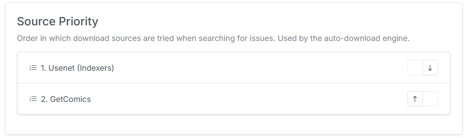
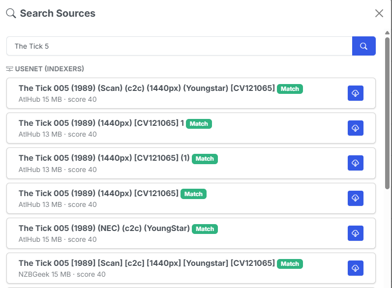

# Source Priority

**Source Priority** governs how CLU prioritizes and queries its three supported download sources: [Direct Downloads (GetComics)](../file-downloads/index.md), [Usenet](index.md), and [DC++](../dcpp/index.md).

Source Priority is configured from the **Download Clients** tab in [Settings](../app-settings/index.md).

{: .center-image }

Each source features an **On / Off toggle** and a draggable handle to set priority order. You can enable any combination of sources according to your preferences (at least one source must remain active). Disabling a source temporarily removes it from auto-download sweeps without deleting its underlying client credentials.

## Automated Sweeps vs. Manual Search

Source Priority behaves differently depending on whether an operation is automated or manual:

| Behavior | [Automated Sweeps](../pull-list/wanted.md) | Manual Search Modal |
| --- | --- | --- |
| **Execution Order** | Sources are queried sequentially in ranked order. | Results sections are **displayed** in ranked order. |
| **Source Membership** | **Only enabled, ranked sources are queried.** Unranked or disabled sources are skipped. | **All configured sources are queried**, regardless of ranking or toggle state. |

!!! warning "Ranking Governs Automated Sweeps"
    If a source is toggled off or omitted from your Source Priority ranking, nightly automated download sweeps will **never** query it — even if its credentials are fully configured.

    In contrast, the manual search modal queries every configured service, ensuring you can always perform manual grabs from any provider by hand.

## Automated Download Cascading

During nightly automated sweeps, CLU processes wanted issues using a cascading priority check:

1. Queries the highest-ranked enabled source for the wanted issue.
2. If an acceptable match is found, CLU queues the download and **stops searching** — lower-ranked sources are skipped for that issue.
3. If no acceptable match is found, CLU falls through to the next ranked source.
4. If no enabled source produces a match, the issue remains wanted and is retried on the next run.

Only high-confidence releases matching the specific series, volume, and issue number are grabbed. Ambiguous releases without issue numbers are never auto-grabbed.

### Cascading Example

With a priority ranking of **Usenet $\rightarrow$ GetComics $\rightarrow$ DC++**:

| Scenario | Result |
| --- | --- |
| Usenet returns a match | Download queued from Usenet. GetComics and DC++ are skipped. |
| Usenet has no match; GetComics returns a match | Download queued from GetComics. DC++ is skipped. |
| Usenet and GetComics have no match; DC++ returns a match | Download queued from DC++. |
| No source returns an acceptable match | The issue remains wanted and is retried on the next sweep. |
| **DC++ configured but toggled off** | DC++ is skipped during automated sweeps, but remains searchable in manual modals. |

## Search Modal Display

In single-issue search modals across the Series page, [Wanted Issues](../pull-list/wanted.md), and [Reading Lists](../collection/reading-lists.md), each source renders under its own labeled section header. Source Priority controls which section appears first at the top of the modal.

{: .center-image }

!!! info "DC++ Search Timing"
    DC++ searches typically require 20–30 seconds because AirDC++ paces its hub queries to respect peer limits. Its section populates progressively after direct download and Usenet results appear. See [DC++ Searching & Grabbing](../dcpp/search-and-grab.md#hub-searches-are-slow-thats-normal).

## Source Priority vs. Download Provider Priority

These two settings control different layers of the download architecture:

- **Source Priority** (this page): Determines which *source system* (GetComics, Usenet, or DC++) to query first for an issue.
- **Download Provider Priority** (in [Download Settings](../app-settings/download-settings.md)): Orders the individual file hosting mirrors *within* GetComics results (e.g. Pixeldrain vs. Mediafire vs. Zippyshare). It has no effect on Usenet or DC++.
